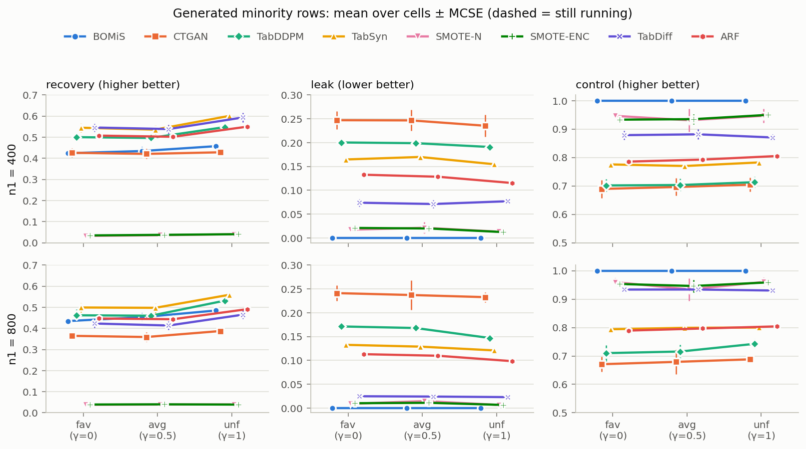

# 쉬운 환경(frequent) 합성 실험 결과 정리 (2026-10-27)

## 요약

- 세 겹침 환경(fav, avg, unf) 모두에서 BOMiS는 **leak 0, control 1.0**을 유지하면서 recovery 0.42–0.49를 냈다.
- SMOTE-N, SMOTE-ENC 대비 recovery가 **+0.39 ~ +0.45** 높다. 두 방법은 SZ 셀을 거의 만들지 못한다(recovery 0.03–0.04).
- CTGAN과는 recovery가 $n_1 = 400$에서 비슷하고(차이 −0.00 ~ +0.03), $n_1 = 800$에서 BOMiS가 +0.07 ~ +0.10 높다. CTGAN은 생성 행의 23–25%가 STZ(leak)라서 control은 BOMiS가 +0.30 ~ +0.33 높다.
- support 단계에서 C(인증)는 180칸 모두 금지 규칙 4개를 인증했고 거짓 인증은 0이었다. 겹침이 커질수록(fav → unf) A(D1만)의 SZ 개수 회수가 떨어지지만 C는 0.96 이상을 유지했다.
- BOMiS가 놓친 SZ 질량은 대부분 **개수 단계**(새로 만드는 셀 수 $L'$가 SZ 셀 수보다 훨씬 적음)에서 생긴다. support 단계 손실은 0.004 이하다.
- DL baseline(TabDDPM, TabSyn, 각 180칸)은 recovery가 BOMiS보다 +0.01 ~ +0.14 높지만, 생성 행의 12–20%가 STZ이고 control은 BOMiS가 +0.20 ~ +0.30 높다(7절).
- TabDiff와 ARF(각 180칸)도 $n_1 = 400$에서는 recovery가 BOMiS보다 높고(+0.07 ~ +0.14), $n_1 = 800$에서는 차이가 MCSE의 2배 안이다. TabDiff는 leak이 가장 낮은 생성 baseline이다($n_1 = 800$에서 0.02). smote(SMOTE-NC 대체)는 ROS처럼 새 셀을 만들지 않는다. ForestDiffusion은 시간 때문에 제외했다(8절).
- 생성 행 기준으로 모든 방법을 같은 정의로 나눠 보면, BOMiS와 DL의 recovery 차이는 **개수 손실**에서 나온다. BOMiS가 맞힌 SZ 셀은 DL·ARF의 약 절반이다. 반면 **선택 손실은 BOMiS가 가장 작고**(0.18–0.20), DL·ARF·CTGAN은 180칸 모두에서 금지 쌍 4개 전부에 행을 만든다(9절).

## 1. 실험 설정

| 항목 | 값 |
|---|---|
| 모집단 | 8열 × 4수준, 모집단 seed 0, 1, 2 (3개) |
| 환경 | STZ 축 frequent(금지 쌍 $\pi_0 = 0.06$) × 겹침 축 3개 |
| 겹침 축 | $Z$(majority가 만들지 못하는 셀)에 놓인 minority 질량 $\omega\gamma$: fav $\gamma=0$ → 0, avg $\gamma=0.5$ → 0.1, unf $\gamma=1$ → 0.2 |
| 표본 | $n_0 = 8000$, $n_1 \in \{400, 800\}$, 표본 seed 0–9 |
| 칸 | (환경, 모집단, $n_1$, seed) 하나. 환경마다 60칸, 합계 180칸. 표의 한 줄은 (환경, $n_1$)마다 30칸 평균 |
| 생성 행 수 | $n_0 - n_1$ (박사형 프로토콜) |
| 불확실성 | ± MCSE = 모집단별 평균의 표준편차 / $\sqrt{3}$ |

방법

- support 단계: **A** = $D_1$만 사용, **B** = $D_0$와 $D_1$을 합쳐서 사용(인증 없음, $r = 0$), **C** = 인증 사용(BOMiS 기본).
- 생성: **BOMiS**(박사형 코드 `vendor/bomis_fa088a9` 수정 없음, 기본 설정, CPU), **ROS**, **SMOTE-N**, **SMOTE-ENC**, **CTGAN**(baseline 프로젝트 `categorical_baselines` 기본 설정).
- 뒤에 추가한 생성 baseline: **TabDDPM**, **TabSyn**(7절), **TabDiff**, **ARF**, **smote**(SMOTE-NC 대체)(8절). ForestDiffusion은 시간 때문에 제외했다(8절). 모두 같은 180칸이다.

지표 (박사형 `bomis/metrics.py` 정의)

- **recovery**: 생성된 서로 다른 셀 중 SZ($S_1$에 있지만 $D_1$에 안 나온 셀)에 해당하는 셀의 $p_1$ 질량 ÷ 빠진 질량 $M_0 = p_1(S_1 \setminus O)$. 높을수록 좋다.
- **leak**: 생성 행 중 $S_1$ 밖(STZ)인 행의 비율. 낮을수록 좋다.
- **control**: $1 - \text{leak}/\text{novel}$. 새 행 중 가능한 셀에 놓인 비율. 높을수록 좋다.
- **SZ 개수 회수**: support 추정 $\hat S$가 덮은 SZ 셀 수 ÷ SZ 셀 수. **STZ 억제**: $\hat S$에서 빠진 금지 쌍 셀의 비율.

## 2. 생성 결과

그림 1. 생성 행 지표. 위 줄 $n_1 = 400$, 아래 줄 $n_1 = 800$. 점은 30칸 평균, 세로 막대는 MCSE. ROS와 smote(SMOTE-NC 대체)는 recovery·leak이 0이라 그림에서 빼고 표(`easy_report_tables.md`)에만 두었다.

| 환경 | $n_1$ | BOMiS recovery | CTGAN recovery | SMOTE-N recovery | SMOTE-ENC recovery | CTGAN leak | CTGAN control |
|---|---|---|---|---|---|---|---|
| fav | 400 | 0.424 ± 0.016 | 0.426 ± 0.021 | 0.032 ± 0.002 | 0.035 ± 0.004 | 0.247 ± 0.019 | 0.689 ± 0.032 |
| fav | 800 | 0.435 ± 0.014 | 0.365 ± 0.018 | 0.038 ± 0.001 | 0.039 ± 0.001 | 0.241 ± 0.017 | 0.671 ± 0.026 |
| avg | 400 | 0.434 ± 0.020 | 0.421 ± 0.024 | 0.036 ± 0.001 | 0.037 ± 0.001 | 0.247 ± 0.022 | 0.696 ± 0.031 |
| avg | 800 | 0.453 ± 0.021 | 0.359 ± 0.023 | 0.039 ± 0.002 | 0.040 ± 0.003 | 0.237 ± 0.031 | 0.679 ± 0.043 |
| unf | 400 | 0.458 ± 0.007 | 0.429 ± 0.013 | 0.040 ± 0.003 | 0.040 ± 0.003 | 0.235 ± 0.023 | 0.704 ± 0.025 |
| unf | 800 | 0.485 ± 0.008 | 0.388 ± 0.014 | 0.040 ± 0.002 | 0.039 ± 0.001 | 0.233 ± 0.011 | 0.688 ± 0.013 |

- BOMiS의 leak은 모든 칸에서 0, control은 1.0이다. SMOTE-N, SMOTE-ENC의 leak은 0.007–0.021, control 0.93–0.96이다. ROS는 새 행을 만들지 않아 recovery와 leak이 모두 0이다.
- CTGAN은 $n_1$이 커지면 recovery가 오히려 0.04–0.06 떨어진다(0.42–0.43 → 0.36–0.39). BOMiS는 $n_1$이 커지면 0.01–0.03 오른다.

### 전체 생성 방법 한눈에 (DL·ARF 포함, recovery / leak, 30칸 평균)

7·8절에 나눠 적은 DL baseline(TabDDPM, TabSyn, TabDiff)과 ARF를 위 방법들과 한 표에 모았다. MCSE와 control은 `easy_report_tables.md`와 7·8절 표에 있다.

| 방법 | fav 400 | fav 800 | avg 400 | avg 800 | unf 400 | unf 800 |
|---|---|---|---|---|---|---|
| **BOMiS** | **0.424 / 0** | **0.435 / 0** | **0.434 / 0** | **0.453 / 0** | **0.458 / 0** | **0.485 / 0** |
| TabSyn | 0.545 / 0.165 | 0.499 / 0.133 | 0.536 / 0.170 | 0.497 / 0.129 | 0.601 / 0.155 | 0.559 / 0.121 |
| TabDiff | 0.546 / 0.074 | 0.423 / 0.025 | 0.539 / 0.071 | 0.414 / 0.024 | 0.594 / 0.077 | 0.465 / 0.023 |
| TabDDPM | 0.500 / 0.200 | 0.462 / 0.171 | 0.497 / 0.199 | 0.460 / 0.168 | 0.548 / 0.191 | 0.532 / 0.147 |
| ARF | 0.508 / 0.133 | 0.447 / 0.113 | 0.502 / 0.128 | 0.443 / 0.110 | 0.550 / 0.115 | 0.491 / 0.098 |
| CTGAN | 0.426 / 0.247 | 0.365 / 0.241 | 0.421 / 0.247 | 0.359 / 0.237 | 0.429 / 0.235 | 0.388 / 0.233 |
| SMOTE-N | 0.032 / 0.017 | 0.038 / 0.009 | 0.036 / 0.021 | 0.039 / 0.015 | 0.040 / 0.013 | 0.040 / 0.007 |
| SMOTE-ENC | 0.035 / 0.021 | 0.039 / 0.010 | 0.037 / 0.020 | 0.040 / 0.011 | 0.040 / 0.012 | 0.039 / 0.007 |
| ROS, smote | 0 / 0 | 0 / 0 | 0 / 0 | 0 / 0 | 0 / 0 | 0 / 0 |

- leak 0을 유지하는 방법 중 새 셀을 만드는 것은 BOMiS뿐이다. ROS와 smote는 새 셀을 만들지 않아 recovery도 0이다.
- recovery만 보면 $n_1 = 400$에서는 DL 세 모델과 ARF가 BOMiS보다 높고, $n_1 = 800$에서 차이가 MCSE의 2배를 넘는 것은 TabSyn(세 환경)과 TabDDPM(unf)뿐이다. 대신 DL 세 모델과 ARF는 생성 행의 2–20%를, CTGAN은 23–25%를 STZ에 둔다. 가장 낮은 것이 $n_1 = 800$의 TabDiff(0.02)다.

### BOMiS − baseline 짝 차이 (같은 칸끼리, 30칸 평균 ± MCSE)

| 환경 | $n_1$ | − CTGAN recovery | − CTGAN leak | − CTGAN control | − SMOTE-N recovery | − SMOTE-ENC recovery |
|---|---|---|---|---|---|---|
| fav | 400 | −0.002 ± 0.011 | −0.247 ± 0.019 | +0.311 ± 0.032 | +0.392 ± 0.016 | +0.390 ± 0.013 |
| fav | 800 | +0.070 ± 0.021 | −0.241 ± 0.017 | +0.329 ± 0.026 | +0.397 ± 0.013 | +0.395 ± 0.013 |
| avg | 400 | +0.013 ± 0.021 | −0.247 ± 0.022 | +0.304 ± 0.031 | +0.399 ± 0.019 | +0.397 ± 0.020 |
| avg | 800 | +0.094 ± 0.019 | −0.237 ± 0.031 | +0.321 ± 0.043 | +0.414 ± 0.019 | +0.413 ± 0.019 |
| unf | 400 | +0.029 ± 0.016 | −0.235 ± 0.023 | +0.296 ± 0.025 | +0.417 ± 0.008 | +0.417 ± 0.007 |
| unf | 800 | +0.097 ± 0.007 | −0.233 ± 0.011 | +0.312 ± 0.013 | +0.445 ± 0.010 | +0.446 ± 0.010 |

## 3. support 단계 A / B / C

그림 2. 왼쪽 SZ 개수 회수, 오른쪽 STZ(금지 쌍 셀) 억제. A와 C의 STZ 억제는 모두 1.0이라 점이 겹친다.

| 환경 | $n_1$ | A SZ 개수 회수 | C SZ 개수 회수 | B STZ 억제 | C 전부 인증 | C 거짓 인증 |
|---|---|---|---|---|---|---|
| fav | 400 | 0.865 ± 0.065 | 0.967 ± 0.030 | 0.756 ± 0.013 | 1.0 | 0 |
| fav | 800 | 0.962 ± 0.021 | 0.989 ± 0.011 | 0.753 ± 0.011 | 1.0 | 0 |
| avg | 400 | 0.854 ± 0.064 | 0.975 ± 0.022 | 0.691 ± 0.005 | 1.0 | 0 |
| avg | 800 | 0.951 ± 0.025 | 0.985 ± 0.012 | 0.689 ± 0.006 | 1.0 | 0 |
| unf | 400 | 0.700 ± 0.104 | 0.957 ± 0.034 | 0.696 ± 0.005 | 1.0 | 0 |
| unf | 800 | 0.867 ± 0.054 | 0.982 ± 0.013 | 0.689 ± 0.006 | 1.0 | 0 |

- 겹침 축의 효과는 생성보다 support 단계에서 크게 보인다. A의 SZ 개수 회수가 fav → unf에서 0.865 → 0.700($n_1 = 400$)으로 떨어진다. C는 0.957–0.989로 유지된다.
- B는 SZ 회수가 C와 같지만 금지 쌍 셀의 24–31%를 허용한다. C는 같은 SZ 회수에서 금지 쌍 셀을 모두 막는다. frequent 환경에서 $n_1 \ge 400$이면 인증 신호 $s = n_0\pi_0/x^*$가 1.41 이상이라 설계상 인증이 거의 확실히 되는 구간이다.
- A의 STZ 억제가 늘 1.0인 것은 설계상 local support가 성립하기 때문이다. 금지 쌍은 $\pi_1 = 0$이라 $D_1$에 나올 수 없고, A는 $D_1$에 나온 조각만 허용하므로 금지 쌍을 항상 막는다.

## 4. BOMiS 회수 손실 분해

그림 3. 빠진 SZ 질량 $M_0$을 1로 두고 나눈 몫. 회수(R4) + 선택 손실 + 개수 손실 + support 손실 = 1.

| 환경 | $n_1$ | support 후 남은 몫 R1 | 개수 손실 | 선택 손실 | 회수 R4 | $\hat M$ | $M_0$ | 새 셀 수 $L'$ | SZ 셀 수 | mask 전 STZ 질량 |
|---|---|---|---|---|---|---|---|---|---|---|
| fav | 400 | 0.997 | 0.379 | 0.194 | 0.424 | 0.665 | 0.669 | 1153 | 27992 | 0.300 |
| fav | 800 | 0.999 | 0.368 | 0.196 | 0.435 | 0.556 | 0.558 | 1475 | 27748 | 0.300 |
| avg | 400 | 0.999 | 0.364 | 0.200 | 0.434 | 0.670 | 0.664 | 1261 | 31971 | 0.283 |
| avg | 800 | 0.999 | 0.351 | 0.195 | 0.453 | 0.561 | 0.556 | 1596 | 31727 | 0.281 |
| unf | 400 | 0.996 | 0.352 | 0.187 | 0.458 | 0.633 | 0.629 | 979 | 31980 | 0.273 |
| unf | 800 | 0.999 | 0.338 | 0.177 | 0.485 | 0.513 | 0.512 | 1223 | 31755 | 0.268 |

- support 손실은 0.004 이하다. C의 $\hat S$가 SZ 질량을 거의 다 덮는다.
- 가장 큰 손실은 개수 단계(0.34–0.38)다. BOMiS가 만드는 새 셀은 1,000–1,600개인데 SZ 셀은 28,000–32,000개라서 질량이 큰 셀 일부만 덮는다.
- 선택 손실(0.18–0.20)은 만든 셀 수만큼 고를 때 질량이 큰 SZ 셀을 놓친 몫이다.
- 빠진 질량 추정 $\hat M$은 $M_0$와 0.006 이내로 맞는다.
- mask가 없는 Transformer 분포는 STZ에 질량 0.27–0.30을 두고, support mask가 이를 0으로 만든다. BOMiS의 leak 0은 mask에서 나온다.

## 5. 해석할 때 주의할 점

- 이번 결과는 STZ 축 frequent 하나, $n_1 \in \{400, 800\}$ 둘뿐이다. frequent에서 $n_1 \ge 400$은 인증이 확실히 되는 구간이라 C에 가장 유리한 조건이다. mid, rare 환경과 작은 $n_1$은 아직 돌리지 않았다.
- 모집단이 3개라 MCSE의 자유도가 2다. 표의 ± 값은 대략적인 크기로 읽어야 한다.
- recovery는 질량 기준이다. 개수 기준(SZ 셀 중 생성된 셀의 비율)으로는 BOMiS 0.03–0.05, CTGAN 0.06–0.07로 CTGAN이 더 높다. CTGAN은 STZ를 포함해 더 많은 서로 다른 셀을 만들기 때문이다.

## 6. 남은 질문

- **unf에서 BOMiS recovery가 fav보다 높은 이유**: 0.424 → 0.458($n_1 = 400$), 0.435 → 0.485($n_1 = 800$). 개수 손실이 0.379 → 0.352로 줄었다. 그런데 새 셀 수 $L'$는 unf에서 오히려 적다(1153 → 979). 따라서 SZ 질량이 더 적은 셀에 몰렸을 가능성이 있다. 아직 확인하지 않았다.

## 7. DL baseline (16:22 완료, 모델당 180칸, 실패 0)

- 대상: TabDDPM(과거 파이프라인 최종 설정: 업데이트 10,000회, diffusion 1,000 step), TabSyn(baseline 프로젝트 기본 설정). 위와 같은 180칸씩.
- TabDDPM은 `categorical_baselines`에 없다. 과거 파이프라인(`Baseline_exp_v4`) 코드의 설정과 안정화 패치를 그대로 부르는 실행기(`baselines/tabddpm_cli.py`)로 돌린다. 숫자 열이 없어서 X_num 파일만 만들지 않는다.
- 배열 job 20883(10:25–16:22). 3칸 동시 실행 기준 TabDDPM 3–6분, TabSyn 8–17분(노드에 따라 다름). 두 모델 모두 첫 시도에서 성공했다.

| 환경 | $n_1$ | TabDDPM recovery / leak / control | TabSyn recovery / leak / control | BOMiS recovery (leak 0, control 1) |
|---|---|---|---|---|
| fav | 400 | 0.500 / 0.200 / 0.702 | 0.545 / 0.165 / 0.776 | 0.424 |
| fav | 800 | 0.462 / 0.171 / 0.710 | 0.499 / 0.133 / 0.794 | 0.435 |
| avg | 400 | 0.497 / 0.199 / 0.703 | 0.536 / 0.170 / 0.770 | 0.434 |
| avg | 800 | 0.460 / 0.168 / 0.716 | 0.497 / 0.129 / 0.799 | 0.453 |
| unf | 400 | 0.548 / 0.191 / 0.713 | 0.601 / 0.155 / 0.783 | 0.458 |
| unf | 800 | 0.532 / 0.147 / 0.743 | 0.559 / 0.121 / 0.800 | 0.485 |

같은 칸끼리 짝 차이(BOMiS − DL, 30칸 평균, recovery ± MCSE):

| 환경 | $n_1$ | − TabDDPM recovery / leak / control | − TabSyn recovery / leak / control |
|---|---|---|---|
| fav | 400 | −0.076 ± 0.006 / −0.200 / +0.298 | −0.121 ± 0.005 / −0.165 / +0.224 |
| fav | 800 | −0.027 ± 0.020 / −0.171 / +0.290 | −0.064 ± 0.016 / −0.133 / +0.206 |
| avg | 400 | −0.062 ± 0.006 / −0.199 / +0.297 | −0.102 ± 0.015 / −0.170 / +0.230 |
| avg | 800 | −0.007 ± 0.012 / −0.168 / +0.284 | −0.044 ± 0.017 / −0.129 / +0.201 |
| unf | 400 | −0.090 ± 0.024 / −0.191 / +0.287 | −0.144 ± 0.021 / −0.155 / +0.217 |
| unf | 800 | −0.047 ± 0.011 / −0.147 / +0.257 | −0.075 ± 0.011 / −0.121 / +0.200 |

- **recovery는 두 DL 모델이 BOMiS보다 높다.** TabSyn이 +0.04 ~ +0.14, TabDDPM이 +0.01 ~ +0.09. 차이는 $n_1 = 400$에서 크고 $n_1 = 800$에서 줄어든다(BOMiS는 $n_1$이 커지면 오르고 두 DL 모델은 내려간다). TabDDPM과의 차이는 avg, $n_1 = 800$에서 −0.007 ± 0.012로 0과 구별되지 않는다.
- **대신 생성 행의 12–20%가 STZ다.** control은 BOMiS가 +0.20 ~ +0.30 높다. CTGAN보다는 leak이 낮다(CTGAN 0.23–0.25).
- 개수 회수도 DL이 높다(TabSyn 0.07–0.09, TabDDPM 0.05–0.06, BOMiS 0.03–0.05). DL 모델은 BOMiS보다 많은 서로 다른 셀을 만든다.
- 따라서 이번 환경에서 BOMiS의 우위는 recovery가 아니라 **leak 0을 유지한 채 얻는 recovery**다. recovery만 보면 DL이 앞선다. 4절의 손실 분해대로 BOMiS 손실 대부분은 새 셀 수($L'$)가 적어서 생긴다.

## 8. 나머지 baseline (10/28 01:55 완료, 방법당 180칸, 실패 0)

박사형 초안의 baseline 목록(ROS, SMOTE-N, SMOTE-NC, SMOTE-ENC, CTGAN, ARF, TabSyn, TabDiff, TabDDPM, ForestDiffusion) 중 남은 것을 같은 180칸 세팅으로 돌렸다.

| 방법 | 설정 | 실행 |
|---|---|---|
| ARF | baseline 프로젝트 기본(트리 30, 반복 10), CPU | 배열 21202, 작업당 약 2.5분, 첫 시도 모두 성공 |
| SMOTE-NC → smote | 범주형 열만 있는 표라 SMOTE-NC는 정의되지 않는다(연속형 열이 하나 이상 필요). baseline 프로젝트의 one-hot SMOTE로 대신 | ARF와 같은 배열 |
| TabDiff | baseline 프로젝트 기본(8000 epoch), GPU | 측정 21200 + 배열 21306(14:07–01:55), 3칸 동시에 칸당 35–50분 |
| ForestDiffusion | 과거 파이프라인 최종 설정(n_t 50, duplicate_K 100, 트리 100, 깊이 7), CPU | **이번에는 제외**(사용자 결정 10/27). 1칸 측정: CPU 8로 3880초(65분). 1인당 CPU 32 한도로 180칸이면 약 48시간이라 일정에 맞지 않는다. 과거 파이프라인에서도 같은 이유로 제외됐다. 측정한 1칸(fav, 모집단 0, $n_1$=400, seed 0)은 recovery 0.61, leak 0.09, control 0.88 |

결과 (30칸 평균 ± MCSE, recovery / leak / control)

| 환경 | $n_1$ | TabDiff | ARF | BOMiS recovery (leak 0, control 1) |
|---|---|---|---|---|
| fav | 400 | 0.546 ± 0.019 / 0.074 / 0.879 | 0.508 ± 0.015 / 0.133 / 0.786 | 0.424 |
| fav | 800 | 0.423 ± 0.020 / 0.025 / 0.934 | 0.447 ± 0.015 / 0.113 / 0.789 | 0.435 |
| avg | 400 | 0.539 ± 0.022 / 0.071 / 0.882 | 0.502 ± 0.017 / 0.128 / 0.793 | 0.434 |
| avg | 800 | 0.414 ± 0.021 / 0.024 / 0.934 | 0.443 ± 0.017 / 0.110 / 0.797 | 0.453 |
| unf | 400 | 0.594 ± 0.023 / 0.077 / 0.870 | 0.550 ± 0.014 / 0.115 / 0.805 | 0.458 |
| unf | 800 | 0.465 ± 0.020 / 0.023 / 0.930 | 0.491 ± 0.011 / 0.098 / 0.804 | 0.485 |

같은 칸끼리 짝 차이 (BOMiS − 방법, recovery ± MCSE / leak / control)

| 환경 | $n_1$ | − TabDiff | − ARF |
|---|---|---|---|
| fav | 400 | −0.122 ± 0.003 / −0.074 / +0.121 | −0.083 ± 0.003 / −0.133 / +0.214 |
| fav | 800 | +0.012 ± 0.020 / −0.025 / +0.066 | −0.012 ± 0.012 / −0.113 / +0.211 |
| avg | 400 | −0.104 ± 0.014 / −0.071 / +0.118 | −0.068 ± 0.014 / −0.128 / +0.207 |
| avg | 800 | +0.039 ± 0.024 / −0.024 / +0.066 | +0.010 ± 0.016 / −0.110 / +0.203 |
| unf | 400 | −0.136 ± 0.028 / −0.077 / +0.130 | −0.092 ± 0.018 / −0.115 / +0.195 |
| unf | 800 | +0.020 ± 0.017 / −0.023 / +0.070 | −0.006 ± 0.006 / −0.098 / +0.196 |

- **TabDiff는 leak이 가장 낮은 생성 baseline이다.** $n_1 = 800$에서 0.023–0.025로 SMOTE 계열(0.007–0.015)과 비슷하고, CTGAN·TabDDPM·TabSyn·ARF(0.10–0.25)보다 훨씬 낮다. $n_1 = 400$에서는 0.07–0.08이다.
- **recovery는 $n_1$에 따라 갈린다.** $n_1 = 400$에서는 TabDiff(+0.10 ~ +0.14)와 ARF(+0.07 ~ +0.09)가 BOMiS보다 높다. $n_1 = 800$에서는 두 방법 모두 BOMiS와의 차이가 MCSE의 2배 안이다(BOMiS − TabDiff +0.01 ~ +0.04, BOMiS − ARF −0.01 ~ +0.01). TabDiff는 $n_1$이 커지면 recovery가 0.12–0.13 내려가고 leak도 같이 내려간다.
- **smote(SMOTE-NC 대체)는 새 셀을 하나도 만들지 않는다.** one-hot으로 보간한 값을 범주로 되돌리면 기존 셀로 돌아가서, recovery·leak·novel이 모두 0이다. 결과가 ROS와 같아 그림에서는 뺐다.
- 따라서 7절의 결론이 그대로 유지된다. BOMiS의 우위는 recovery가 아니라 **leak 0을 유지한 채 얻는 recovery**다. 이 기준에서 가장 가까운 baseline은 $n_1 = 800$의 TabDiff(recovery 차이 MCSE의 2배 안, leak 0.02)다.

## 9. 개수 회수·손실 분해·금지 쌍: BOMiS와 생성 baseline 비교

3절의 SZ 개수 회수·STZ 억제는 support 추정 $\hat S$의 지표라서 support 단계가 있는 A/B/C(BOMiS)에만 있다. DL baseline은 support를 따로 추정하지 않고 바로 행을 생성한다. 그래서 여기서는 **생성된 행**에서 같은 성격의 지표를 모든 방법에 똑같이 계산했다(`scripts/compare_counts.py`, 전체 표 `reports/easy_counts.md`).

- 맞힌 SZ 셀 수 $k$: 생성 행에 나온 서로 다른 SZ 셀 수. BOMiS는 4절의 $L'$와 같다(새 셀이 모두 SZ).
- SZ 개수 회수(생성): $k$ ÷ SZ 셀 수. 3절의 $\hat S$ 기준 개수 회수(C 0.96–0.99)와 다른 값이다. $\hat S$가 덮은 셀 중 실제로 만든 셀만 센다.
- 개수 손실 = 1 − (질량 큰 SZ 셀 $k$개의 $p_1$ 합 ÷ $M_0$). $k$개로 얻을 수 있는 최대 회수에 못 미친 몫이다. 선택 손실 = 그 최대 회수 − recovery. 4절과 같은 정의이고, support 손실(BOMiS 0.004 이하)은 개수 손실에 합쳤다.
- 금지 쌍 행 비율: 금지 쌍 4개에 놓인 생성 행의 몫(4개 합, 한 행이 두 쌍에 걸리면 두 번 센다). 금지 쌍 회피: 4개 중 생성 행이 하나도 없는 쌍의 몫.

값은 세 환경(fav, avg, unf)의 30칸 평균이 놓인 범위다. 환경별 값과 MCSE는 `easy_counts.md`에 있다.

$n_1 = 400$

| 방법 | recovery | 맞힌 SZ 셀 수 $k$ | SZ 개수 회수(생성) | 개수 손실 | 선택 손실 | 금지 쌍 행 비율 | 금지 쌍 회피 |
|---|---|---|---|---|---|---|---|
| **BOMiS** | 0.424–0.458 | 979–1261 | 0.030–0.041 | 0.355–0.382 | **0.187–0.200** | **0** | **1.0** |
| TabSyn | 0.536–0.601 | 2315–2427 | 0.072–0.085 | 0.177–0.235 | 0.220–0.231 | 0.143–0.159 | 0 |
| TabDiff | 0.539–0.594 | 2023–2260 | 0.063–0.080 | 0.202–0.246 | 0.205–0.215 | 0.062–0.068 | 0 |
| TabDDPM | 0.497–0.548 | 1656–1688 | 0.052–0.059 | 0.238–0.308 | 0.192–0.214 | 0.203–0.215 | 0 |
| ARF | 0.502–0.550 | 2226–2388 | 0.069–0.083 | 0.184–0.240 | 0.253–0.266 | 0.094–0.109 | 0 |
| CTGAN | 0.421–0.429 | 1972–2165 | 0.061–0.072 | 0.209–0.268 | 0.306–0.362 | 0.197–0.213 | 0 |
| SMOTE-N | 0.032–0.040 | 60–81 | 0.002–0.003 | 0.808–0.824 | 0.136–0.160 | 0.010–0.016 | 0.65–0.70 |
| SMOTE-ENC | 0.035–0.040 | 59–82 | 0.002–0.003 | 0.806–0.826 | 0.133–0.159 | 0.010–0.015 | 0.56–0.68 |

$n_1 = 800$

| 방법 | recovery | 맞힌 SZ 셀 수 $k$ | SZ 개수 회수(생성) | 개수 손실 | 선택 손실 | 금지 쌍 행 비율 | 금지 쌍 회피 |
|---|---|---|---|---|---|---|---|
| **BOMiS** | 0.435–0.485 | 1223–1596 | 0.038–0.053 | 0.338–0.369 | **0.177–0.196** | **0** | **1.0** |
| TabSyn | 0.497–0.559 | 2155–2381 | 0.068–0.084 | 0.214–0.266 | 0.227–0.239 | 0.110–0.122 | 0 |
| TabDiff | 0.414–0.465 | 1421–1655 | 0.045–0.060 | 0.302–0.342 | 0.233–0.244 | 0.017–0.018 | 0 |
| TabDDPM | 0.460–0.532 | 1742–1768 | 0.055–0.062 | 0.258–0.331 | 0.207–0.213 | 0.151–0.179 | 0 |
| ARF | 0.443–0.491 | 2003–2214 | 0.063–0.078 | 0.229–0.283 | 0.270–0.280 | 0.079–0.089 | 0 |
| CTGAN | 0.359–0.388 | 1904–1960 | 0.060–0.069 | 0.240–0.309 | 0.326–0.372 | 0.191–0.200 | 0 |
| SMOTE-N | 0.038–0.040 | 83–114 | 0.003–0.004 | 0.807–0.816 | 0.145–0.155 | 0.004–0.010 | 0.67–0.68 |
| SMOTE-ENC | 0.039–0.040 | 80–112 | 0.002–0.004 | 0.808–0.821 | 0.140–0.152 | 0.005–0.008 | 0.55–0.63 |

- **recovery 차이는 개수에서 나온다.** BOMiS가 맞힌 SZ 셀은 1,000–1,600개로, TabSyn·ARF·TabDiff($n_1 = 400$)의 절반 정도다. 그래서 개수 손실이 0.34–0.38로 생성 방법 중 가장 크다. DL과 ARF는 0.18–0.34다.
- **선택 손실은 BOMiS가 생성 방법 중 가장 작다**(0.18–0.20, TabDDPM 0.19–0.21과 비슷). 만든 셀 하나하나는 질량이 큰 SZ 셀을 잘 고른다는 뜻이다. CTGAN(0.31–0.37)과 ARF(0.25–0.28)는 셀을 많이 만들지만 가벼운 셀이 많다.
- $n_1 = 800$의 TabDiff는 $k$가 1,400–1,650개로 BOMiS와 비슷해지고 개수 손실도 0.30–0.34로 비슷하다. 2·8절에서 둘의 recovery 차이가 MCSE의 2배 안이었던 것과 맞는다.
- **금지 쌍은 셀을 많이 만드는 baseline이 모두 뚫는다.** TabSyn, TabDiff, TabDDPM, ARF, CTGAN은 180칸 모두에서 금지 쌍 4개 전부에 행을 만들었다(회피 0). 가장 적은 TabDiff도 $n_1 = 800$에서 생성 행의 약 2%가 금지 쌍에 놓인다. SMOTE 계열은 새 셀을 거의 만들지 않아 쌍의 55–70%를 피한다. BOMiS만 모든 칸에서 4개를 모두 피한다.
- 정리하면 BOMiS의 개수 단계($L'$를 늘리는 것)가 recovery 차이를 줄일 수 있는 지점이다. 선택과 금지 쌍 억제에서는 이미 baseline보다 낫다.

## 파일

| 내용 | 위치 |
|---|---|
| 그림·표 생성 | `scripts/make_easy_report.py` (tabular_foundation env, srun) → `reports/figures/easy_fig*.png`, `reports/easy_report_tables.md`(전체 지표 표) |
| 개수 회수·손실 분해·금지 쌍 비교(9절) | `scripts/compare_counts.py` (bomis env, sbatch) → `reports/easy_counts.md`, `easy_counts.csv` |
| 환경별 원래 요약 | `reports/easy_preview.md`, `easy_preview_avg.md`, `easy_preview_unf.md` |
| 실행 기록 | `experiments/run_log_easy.md` (job 20207·20208·20284·20288–20291, DL 20883, ARF·smote 21202, TabDiff 21200·21306, ForestDiffusion 21252) |
| 칸별 결과 | `/mnt/data1/calvinkim1027/BOMIS_new_수만이형_runtime/results/easy{,_avg,_unf}/<방법>/<pop>_<n1>_<seed>.csv` |
