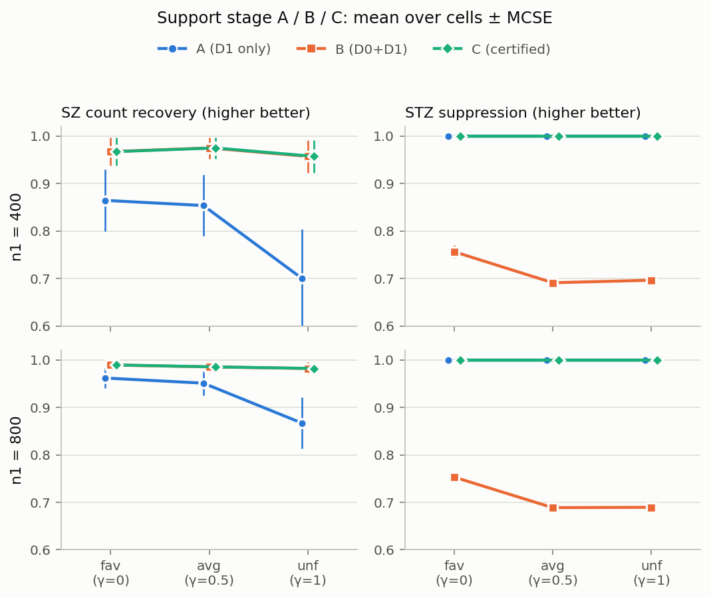
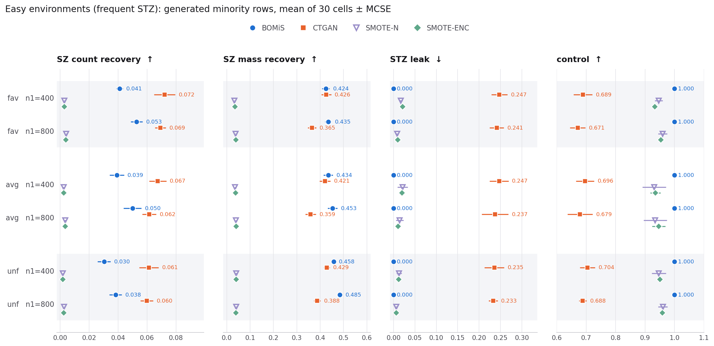
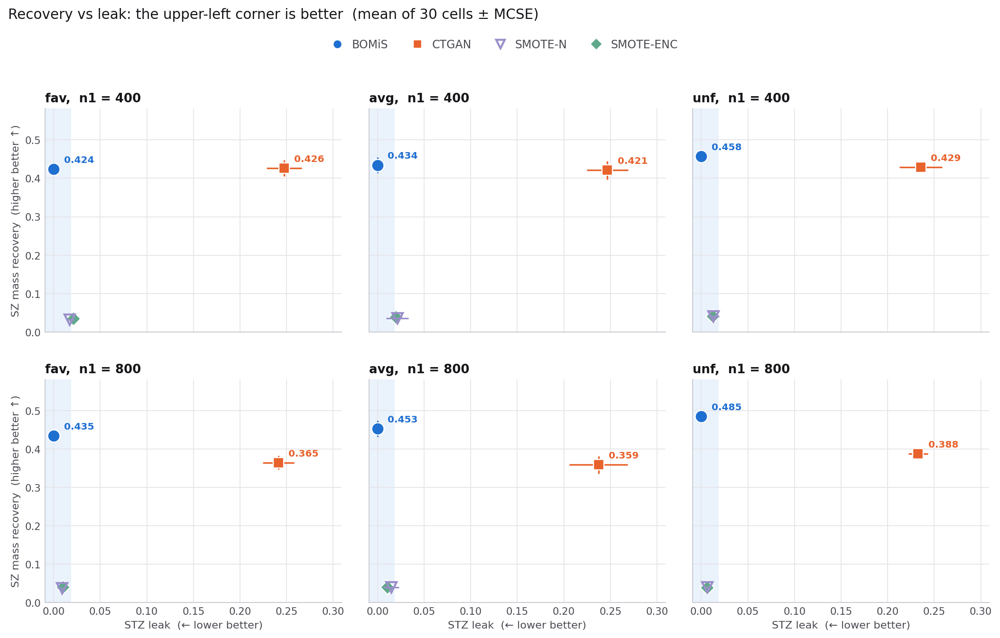
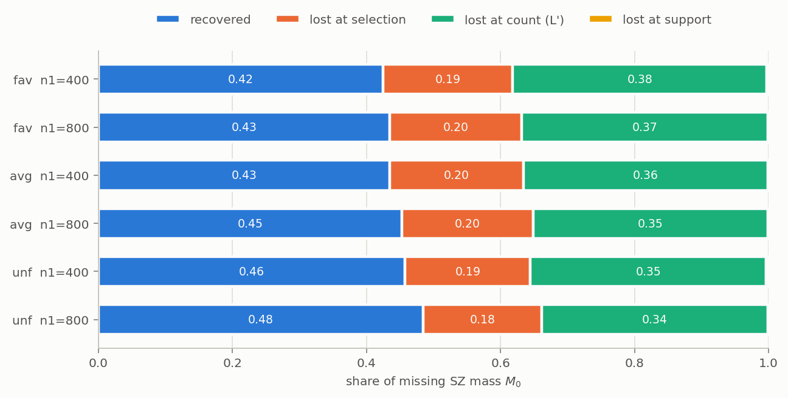

# BOMiS 합성 실험: 쉬운 환경 결과와 설계 근거 (2026-10-27)

이 문서는 10/27에 돌린 합성 실험 하나를 처음 보는 사람이 끝까지 따라갈 수 있게 정리한 통합본이다. 설계 문서(`docs/superpowers/specs/2026-10-26-synthetic-study-ademp-design.md`), 결과 문서(`reports/easy_results_1027.md`), 실행 기록(`experiments/run_log_easy.md`)과 1단계 점검 보고서(`stage1_dgp_check.md`)의 내용을 합쳤고, 결과 문서의 지표 설명 두 곳을 바로잡았다(5.4절, 6.3절). DL baseline은 끝난 CTGAN만 넣었다. TabDDPM, TabSyn, TabDiff, ARF는 실행 중이라 나중에 추가한다. 10/28에 생성 단계 손실 분해를 보강하고(6.3절) Chao1 상한 ablation 결과를 추가했다(6.4절).

## 0. 요약

- **무엇을 했나.** 정답 support를 정확히 아는 합성 모집단(8열 × 4수준, 셀 65,536개)을 만들고, 박사형 BOMiS 코드(커밋 `fa088a9`, 수정 없음)와 baseline 4개(ROS, SMOTE-N, SMOTE-ENC, CTGAN)를 돌렸다. 범위는 인증이 확실히 되는 쉬운 환경(STZ 축 frequent) × 겹침 축 3개(fav, avg, unf) × $n_1 \in \{400, 800\}$, 모집단 3개 × 표본 seed 10개로 180칸이다.
- **support 단계.** 인증을 쓰는 C(BOMiS가 내부에서 쓰는 설정)는 180칸 모두 금지 쌍 4개를 인증했고 거짓 인증은 0이었다. C는 인증 없는 B와 같은 SZ를 회수하면서(개수 0.96–0.99) STZ를 모두 막았다. $D_1$만 쓰는 A는 STZ를 모두 막지만 SZ 개수 회수가 0.70–0.96으로 낮다.
- **생성 단계.** BOMiS는 모든 칸에서 leak 0, control 1.0이고 SZ 질량 회수는 0.42–0.49다. CTGAN과 질량 회수는 $n_1 = 400$에서 비슷하고 $n_1 = 800$에서 BOMiS가 0.07–0.10 높다. CTGAN은 생성 행의 23–25%가 STZ다. SMOTE-N, SMOTE-ENC는 질량 회수가 0.03–0.04다.
- **support에서 생성으로 넘어가며 회수가 절반 이하로 줄어든다.** support가 덮은 SZ 질량은 0.996–0.999인데 생성 행이 회수한 질량은 0.42–0.49다. 줄어든 몫의 약 2/3(0.34–0.38)는 BOMiS가 만드는 새 셀 수가 Chao1 추정값(980–1,600개)으로 정해지기 때문에 생긴다. 실제 SZ 셀은 28,000–32,000개다. 이 개수 손실 가운데 0.07–0.16은 생성 행 수($n_0 - n_1$)로는 어떤 방법도 피할 수 없는 몫이고, 0.19–0.28이 Chao1 상한 때문에 생긴다. 나머지(0.18–0.20)는 그 개수 안에서 질량이 큰 SZ 셀을 고르지 못한 몫이다.
- **Chao1 상한만 풀면(ablation) 회수가 0.69–0.81로 오른다.** 같은 학습 모델에서 새 셀 수 상한만 없애자 SZ 질량 회수가 칸마다 짝 차이로 +0.23–0.36 올랐고 leak은 0을 유지했다. 대신 주변분포 일치(uni_tv, pair_tv)가 0.004–0.018 나빠졌는데, 이 값은 CTGAN(0.13–0.17, 0.20–0.26)보다 여전히 훨씬 작다. 지표가 서로 다른 셀의 질량을 세기 때문에 넓게 뿌릴수록 회수가 오르는 성질이 있어, 이 결과는 "설계 하나가 손실 대부분을 만든다"로 읽고 방법의 결함으로 단정하지 않는다(6.4절).
- **주의.** 쉬운 환경 하나만 돌렸고(C에 가장 유리한 조건), 모집단이 3개라 MCSE의 자유도가 2다. 개발용 모집단이며 최종 보고용 모집단(seed 1000번대)은 아직 쓰지 않았다.

## 1. 질문과 용어

### 1.1 질문

박사형 BOMiS를 BASE로 새 Method를 개발한다(10/19 회의). 새 Method를 제안하기 전에, BASE가 어떤 환경에서 되고 어떤 환경에서 실패하는지를 정답을 아는 데이터에서 숫자로 확인한다.

- **Q1.** 인증은 언제 작동하는가. 가능한 조각을 잘못 인증하지 않는가(FWER), 진짜 금지 쌍을 얼마나 인증하는가(검정력)
- **Q2.** majority 정보를 쓰면 SZ를 얼마나 더 회수하는가(A 대 B)
- **Q3.** majority 정보를 쓰면서 들어온 STZ를 인증이 얼마나 막는가(A, B, C)
- **Q4.** BOMiS 전체의 회수와 누출을 baseline과 비교하고, BOMiS의 세 부분(① support, ② 새 질량 할당, ③ 디코더) 중 어디에서 회수가 줄어드는지 본다

이번 실행은 Q1–Q3을 쉬운 환경에서 확인하고(예측이 미리 정해진 영역, 3.4절), Q4를 처음 본다.

### 1.2 용어

| 기호 | 뜻 |
|---|---|
| $U$ | 셀 공간. 8열 × 4수준 = $4^8 = 65{,}536$개 셀 |
| $p_0$, $p_1$ | majority, minority 모집단 분포(길이 65,536인 확률 벡터) |
| $S_0$, $S_1$ | $p_0 > 0$, $p_1 > 0$인 셀(참 support) |
| $D_0$, $D_1$ | 표본. $n_0 = 8000$, $n_1 \in \{400, 800\}$ |
| $O$ | $D_1$에 나온 서로 다른 셀 |
| 조각 $\beta$ | 열 1개 또는 2개와 그 값. 1차 32개 + 2차 448개 = $m = 480$개 |
| $\pi_0(\beta)$, $\pi_1(\beta)$ | 조각 확률(그 조각을 포함하는 셀의 $p_0$, $p_1$ 합) |
| **SZ** (sampling zero) | $S_1 \setminus O$. minority 모집단에는 있지만 표본에 안 나온 셀. 생성으로 채워야 할 곳 |
| $M_0$ | $p_1(\text{SZ})$. 표본이 놓친 minority 질량 |
| **STZ** (structural zero) | $U \setminus S_1$. minority 모집단에 없는 셀. 생성하면 안 되는 곳(박사형과 합의한 정의, 종류 구분 없음) |
| 금지 쌍 | $\pi_0 > 0$이고 $\pi_1 = 0$인 2차 조각. majority는 만들지만 minority는 만들지 않는 규칙 |
| **floor 가정** | $\pi_1 > 0$인 모든 1·2차 조각에서 $\pi_1(\beta) \ge r\,\pi_0(\beta)$. 이번 설정 $r = 1/2$ |
| **local support 가정** | $S_1$이 "1·2차 조각이 모두 $\pi_1 > 0$인 셀"과 같다. minority support가 쌍 단위 규칙으로 정해진다 |
| **인증** | $D_1$에 0번, $D_0$에 $x^*$번 이상 나온 조각을 금지 쌍으로 판정하는 것. floor 가정 아래에서 가능한 조각을 잘못 인증할 확률이 $\alpha/m$ 이하가 되게 $x^*$를 정한다(박사형 `certify_threshold`) |

floor 가정이 왜 필요한지: 가능한 조각이면 $\pi_1 \ge r\pi_0$이므로, majority에 자주 나오는 조각은 minority에도 나올 가능성이 높다. 그래서 majority에 많이 나왔는데 minority에 한 번도 안 나온 조각은 금지 쌍이라고 판정할 근거가 된다. 이 판정이 FWER 보장을 가지려면 모집단이 floor 가정을 실제로 만족해야 하고, DGP는 이것을 구성으로 보장해야 한다(3.2절).

## 2. 데이터 생성 (DGP)

### 2.1 majority 법칙 $p_0$

- **트리 구조(고정).** 부모 열 $P_1$–$P_4$(열 0–3)를 사슬로 잇고($P_1 - P_2 - P_3 - P_4$), 각 부모에 잎 하나를 붙인다($P_i - L_i$, 잎은 열 4–7).
- **조건부 표.** 뿌리 주변분포와 7개 간선의 조건부 표 각 행을 Dirichlet(1)에서 뽑는다.
- **부모 쌍 위의 0.** 공유 0 6개(부모 쌍마다 하나, 두 클래스 모두 만들지 않음)와 majority 전용 0 2개($Z$ 쌍, minority만 만들 수 있음)를 부모 쌍에만 둔다. 0으로 만들기 전 질량이 0.05를 넘는 값 쌍은 고르지 않는다.
- $p_0$는 트리 법칙에서 0을 포함하는 셀을 0으로 만들고 다시 정규화한 것이다.

### 2.2 금지 쌍 심기

잎 조건부 표의 행에 목표 확률을 직접 넣어 금지 쌍을 만든다(무작위 표에서 찾는 방식은 seed 300개에서 수락 0%였다).

- 간선 $i$마다 $a'_i = \arg\max_v P_0(P_i = v)$, 잎 값 $a$를 하나 골라
  $$P(L_i = a \mid P_i = a'_i) = \frac{t}{P_0(P_i = a'_i)}$$
  로 둔다. 잎은 부모가 주어지면 나머지 열과 독립이므로 금지 쌍 $(P_i = a'_i, L_i = a)$의 $\pi_0$는 정확히 목표값 $t$가 된다.
- 금지 쌍은 잎 간선 4개에 하나씩, 환경마다 4개다.
- 손실 비율을 $e = t/P_0(a'_i)$로 쓴다. frequent($t = 0.06$)는 $e \le 0.2$를 지키려고 $P_0(a'_i) \ge 0.3$이 아니면 seed를 거절한다.

### 2.3 minority 법칙 $p_1$: 질량 이동과 섞기

영역 정의
- $R$: $S_0$의 셀 중 금지 쌍을 하나도 포함하지 않는 셀(두 클래스 모두 만드는 영역)
- $Z$: $Z$ 쌍을 포함하고 공유 0과 금지 쌍은 포함하지 않는 셀(majority는 못 만드는 영역)
- $S_1 = R \cup Z$ ($\gamma > 0$), $S_1 = R$ ($\gamma = 0$)

구성
1. **질량 이동.** 금지 쌍을 포함하는 셀의 질량을 버리지 않고, 그 금지 쌍들의 부모 좌표 $a'_i$만 다른 값으로 바꾼 $R$ 안의 셀로 똑같이 나눈다. 결과가 $p_1^{\text{base}}$다.
2. **섞기.** 같은 트리에 독립적으로 뽑은 표로 법칙 $h$를 만들고
   $$p_1 = (1-\omega)\, p_1^{\text{base}} + \omega\big[(1-\gamma)\, h(\cdot \mid R) + \gamma\, h(\cdot \mid Z)\big], \qquad \omega = 0.2$$
   로 둔다. $Z$에 놓인 minority 질량은 정확히 $\omega\gamma$다.

### 2.4 환경 축 두 개

| 축 | 바꾸는 것 | 유리 | 평균 | 불리 |
|---|---|---|---|---|
| STZ 축: STZ가 majority에 드러나는 정도 | 금지 쌍의 $\pi_0$ | frequent 0.06 | mid 0.03 | rare 0.005 |
| 겹침 축: SZ가 majority에 드러나는 정도 | $Z$에 놓인 minority 질량 $\omega\gamma$ | fav 0 ($\gamma = 0$) | avg 0.1 ($\gamma = 0.5$) | unf 0.2 ($\gamma = 1$) |

- 설계 전체는 3 × 3 = 9환경이고, 모든 환경에서 local support 가정이 성립한다. 가정이 깨지는 환경(쌍으로 설명되지 않는 3변수 금지 규칙)은 일정상 뺐다(10/27 결정, 18환경 판은 `docs/outdated/`에 보관).
- **짝지은 설계.** seed 하나에서 $p_0$ 표, $h$ 표, 0의 위치, 심은 금지 쌍, $D_0$와 $D_1$의 난수를 공유하고 9개 환경을 만든다. 환경 사이의 차이에 다른 요인이 섞이지 않는다. $D_1$은 $n_1$ 사이에서 포함 관계다(앞의 $n_1$개).

## 3. 설정값과 그 이유

### 3.1 값별 근거

| 설정 | 값 | 이유 |
|---|---|---|
| 셀 공간 | 8열 × 4수준 | 65,536셀이라 모든 정답과 지표를 셀 나열로 정확히 계산할 수 있다. 수준을 5 이상으로 올리면 심기 조건 통과가 21% 이하로 떨어진다(10/27 측정) |
| 트리 구조 | 부모 사슬 + 잎, 고정 | 잎이 부모가 주어지면 나머지와 독립이라 (1) 금지 쌍의 $\pi_0$를 정확히 맞출 수 있고 (2) floor를 구성으로 증명할 수 있다(3.2절) |
| 0의 위치 | 부모 쌍에만 | 0의 지시함수가 부모 열에만 의존하면 다시 정규화해도 잎의 조건부 독립이 유지된다 |
| 0 후보 | 0으로 만들기 전 질량 ≤ 0.05 | v1 설정값(별도 근거 기록 없음) |
| Dirichlet 모수 | $\eta = 1$ | 단체 위 균등분포. 심기로 바꾼 뒤 수락률이 높아 따로 고를 이유가 없다 |
| floor 상수 | $r = 1/2$ | 박사형 코드 기본값. 초안의 $r = 1/8$이면 $n_1 \le 200$에서 인증이 원리상 불가능하다 |
| 손실 상한 | $e \le 0.2$ | floor 증명에 필요(3.2절) |
| 섞기 가중치 | $\omega = 0.2$ | floor 증명에서 $(1-\omega)(1-0.36) \ge 1/2$이려면 $\omega \le 0.219$. 0.2는 그 아래 값 |
| 겹침 축 상한 | $\omega\gamma \le 0.2$ | $\gamma \le 1$이라 $\omega$가 곧 상한 |
| STZ 축 frequent | $\pi_0 = 0.06$ | 3.3절 |
| STZ 축 mid, rare | 0.03, 0.005 | 인증 경계를 넘는 $n_1$이 800, 없음이 되게(3.4절) |
| $n_0$ | 8000 | v1에서 고정. 이 값에서 frequent의 인증 경계가 $n_1 = 400$에 온다 |
| $n_1$ | 설계 50–800, 이번 실행 400, 800 | 관심 범위 50–400, 800은 mid의 경계 확인용. 이번에 400, 800만 돌린 이유는 4.1절 |
| 인증 수준 | $\alpha = 0.05$, Bonferroni $\alpha/m = 0.05/480$ | 박사형 코드 기본값. $\tau = \log(m/\alpha) \approx 9.17$ |
| $h$ 섞기 | 유지 | $h$ 없이 $Z$에만 질량을 넣는 단순화안과 비교하면, support 단계 결과는 같고(차이 0.006 이하), 현재 방식만 두 클래스 차이(평균 쌍 주변분포 TV)를 $\gamma$와 무관하게 0.12–0.15로 유지한다. 그래서 $\gamma$가 $R$과 $Z$에 질량을 나누는 비율만 바꾼다 |
| 생성 행 수 | $n_0 - n_1$ | 박사형 프로토콜(클래스 균형을 맞추는 수) |

### 3.2 floor가 구성상 성립하는 이유

버린 질량이 없을 때, $\pi_0 > 0$이고 $\pi_1 > 0$인 모든 1·2차 조각에서 $\pi_1/\pi_0 \ge 0.512$임을 보인다.

1. **어떤 조각이 질량을 잃는가.** 질량 이동은 금지 쌍의 부모 좌표 $a'_i$만 바꾼다. 그래서 부모 열을 $a'_i$로 고정한 조각만 질량을 잃는다. 잎 값만 고정한 조각이나 다른 부모 열만 고정한 조각은 옮겨진 셀이 여전히 그 조각에 속한다.
2. **부모 값 하나를 고정한 조각** $(P_i = a'_i)$, $(P_i = a'_i, X)$: 잎의 조건부 독립 때문에 잃는 비율은 $e \le 0.2$다.
3. **부모 값 둘을 고정한 조각** $(P_i = a'_i, P_j = a'_j)$: 두 금지 사건 $\{L_i = a_i\}$, $\{L_j = a_j\}$는 부모가 주어지면 독립이므로
   $$P(A \cup B) = 1 - (1-e_A)(1-e_B) \le 1 - 0.8^2 = 0.36$$
4. **섞기.** 모든 조각을 $(1-\omega)$배 한 뒤 질량을 더하기만 하고, 재정규화는 비율을 키우기만 한다. 따라서
   $$\frac{\pi_1}{\pi_0} \ge (1-\omega)(1-0.36) = 0.8 \times 0.64 = 0.512 \ge r = \frac12$$
5. **버린 질량이 있으면**(옮길 곳이 없는 셀) 증명이 성립하지 않는다. 이 경우는 정확 점검으로 판정하고, 통과하지 못하면 seed를 거절한다.

**박사형 closure 방식(자르기)을 쓰지 않은 이유.** $p_1 \propto p_0 \cdot 1[S_1]$로 자르면 금지 셀이 통째로 사라져 잎 값만 고정한 조각도 질량을 잃는다. 예를 들어 $P_0(L_i = a) = 0.08$이고 그중 0.06이 금지 쌍에서 오면 조각 $(L_i = a)$는 75%를 잃고, 정규화 뒤에도 $\pi_1/\pi_0 \approx 0.25/0.76 \approx 0.33 < 1/2$이 되어 floor가 깨진다. 질량 이동은 부모 좌표만 바꾸므로 $L_i = a$가 남는다.

**실제 값(1단계 점검, 모집단 10개).** frequent 환경의 floor 최솟값은 fav 0.584–0.632, avg 0.571–0.614, unf 0.550–0.593으로 모두 1/2 이상이다. 버린 질량은 최대 0.004다.

### 3.3 frequent를 $\pi_0 = 0.06$으로 정한 계산

- 심기에서 $\pi_0 = e \cdot P_0(a')$이고 floor 때문에 $e \le 0.2$다. 따라서 $\pi_0 \le 0.2\, P_0(a')$다.
- $\pi_0 = 0.06$이면 $P_0(a') \ge 0.3$이 필요하다. 부모 4개 각각에서 가장 흔한 값의 확률이 0.3 이상이면 되고, seed 1000개 중 903개가 통과했다.
- v1의 0.12였다면 $P_0(a') \ge 0.6$이 네 부모에서 동시에 필요해 거의 통과하지 못한다.
- 그리고 0.06이면 인증 경계가 $n_1 = 400$에 온다(3.4절). 즉 0.06은 floor를 지키면서 대부분의 seed에서 심을 수 있고, 관심 범위 안에서 인증이 켜지는 값이다.

**수락률(10/27 측정).** 심기까지 통과 903/1000. 9개 환경 정확 점검까지 통과 48/60(80%). 거절은 `no_plant`(가장 흔한 부모 값 확률 < 0.3) 8개, floor 점검 4개(모두 버린 질량이 있는 seed)다.

### 3.4 인증 경계: 어느 $n_1$에서 인증이 켜지는가

박사형 코드의 기준값 $x^* = $ `certify_threshold(n0=8000, n1, r=0.5, alpha/m)`와 인증 신호 $s = n_0\pi_0/x^*$(majority 기대 개수 ÷ 기준값)는 다음과 같다.

| $n_1$ | 50 | 100 | 200 | 400 | 800 |
|---|---:|---:|---:|---:|---:|
| $x^*$ | 2603 | 1346 | 680 | 340 | 170 |
| frequent $s$ | 0.18 | 0.36 | 0.71 | **1.41** | **2.82** |
| mid $s$ | 0.09 | 0.18 | 0.35 | 0.71 | **1.41** |
| rare $s$ | 0.02 | 0.03 | 0.06 | 0.12 | 0.24 |

- frequent, $n_1 = 400$에서 금지 쌍의 $N_0 \sim \text{Bin}(8000, 0.06)$은 평균 480, 표준편차 21.2이고 기준값은 340이다. 그래서 인증 확률이 사실상 1이다. 이론 신호로도 $n_1 r \pi_0 = 400 \times 0.5 \times 0.06 = 12 > \tau \approx 9.17$이다.
- 경계 양쪽의 정확 검정력은 거의 0 또는 1이다. 그래서 세 수준이 "$n_1 \ge 400$에서 확실히 인증 / $n_1 = 800$에서만 / 끝까지 안 됨"으로 갈린다.
- **미리 정해지는 것.** 금지 쌍 셀은 A가 항상 막고($\pi_1 = 0$이라 $D_1$에 나올 수 없음), B는 막지 못하며($N_0$가 커서 기본 허용), C는 인증될 때만 막는다. 그래서 금지 쌍에 대한 Q1, Q3 결과는 해석적 예측이고, 시뮬레이션은 구현이 그 예측을 재현하는지 확인한다. 새로 알게 되는 것은 Q2(SZ 회수), C가 인증 때문에 함께 잃는 SZ, BOMiS 생성 결과다.

### 3.5 겹침 축의 의미

- $Z$의 SZ는 $p_0 = 0$이라 majority 표본에 나올 수 없다. 그래서 $\gamma$가 클수록(unf) majority 정보로 얻을 수 있는 SZ가 줄어든다.
- $\gamma = 0$(fav)이면 $Z$의 셀도 minority에 없으므로 STZ가 된다. 그래서 fav의 STZ 셀 수(36,677)가 avg, unf(32,168)보다 많다.

## 4. 이번 실행의 범위

### 4.1 쉬운 환경부터 돌린 이유

- **진행 순서(10/27 결정, 박사형 조언).** 방법이 잘 되는 설정을 먼저 찾고 축을 하나씩 불리하게 넓힌다.
- **비용.** BOMiS 기본 설정 fit 한 번이 약 10분(CPU 4개, 585초)이다. 학습 길이 후보 4개 × 5겹 교차검증으로 Transformer를 20번 새로 학습하기 때문이다. 전체 격자(9환경 × 5 $n_1$ × 200회)는 8개 동시로 약 7.6일이 걸린다.
- **frequent × $n_1 \in \{400, 800\}$.** 인증이 확실히 되는 유일한 구간이다(3.4절). 인증이 작동할 때 BOMiS가 무엇을 하는지를 먼저 본다.
- **겹침 축 3개 모두.** 처음에는 `frequent__fav`만 계획했고, fav 결과를 본 뒤 같은 frequent에서 avg, unf를 추가했다(10/27 03:3x 결정).

### 4.2 실행 설정

| 항목 | 값 |
|---|---|
| 환경 | `frequent__fav`, `frequent__avg`, `frequent__unf` |
| 모집단 | 개발용 seed 0, 1, 2 (수락된 처음 3개) |
| 표본 | $n_0 = 8000$, $n_1 \in \{400, 800\}$, 표본 seed 0–9 |
| 칸 | (환경, 모집단, $n_1$, 표본 seed) 하나. 환경마다 60칸, 합계 180칸 |
| 방법 | support A/B/C, BOMiS, ROS, SMOTE-N, SMOTE-ENC, CTGAN (8개 × 180칸 = 1,440행, 실패 0) |
| 실행 | 10/27 03:20–07:29. BOMiS·SMOTE·A/B/C는 CPU(칸당 약 15분, 4코어), CTGAN은 GPU(칸당 1.5–8분) |
| 불확실성 | 칸 평균 ± MCSE. MCSE = 모집단별 평균의 표준편차 / $\sqrt{3}$ (참값이 모집단마다 달라 모집단을 군집으로 본다) |

### 4.3 모집단과 표본의 정답 (이번 3개 모집단, 30칸 평균)

| 환경 | $\lvert S_1 \rvert$ | STZ 셀 수 | $n_1$ | SZ 셀 수 | $M_0$ |
|---|---:|---:|---:|---:|---:|
| fav | 28,859 | 36,677 | 400 | 27,992 | 0.669 |
| | | | 800 | 27,748 | 0.558 |
| avg | 33,368 | 32,168 | 400 | 31,971 | 0.664 |
| | | | 800 | 31,727 | 0.556 |
| unf | 33,368 | 32,168 | 400 | 31,980 | 0.629 |
| | | | 800 | 31,755 | 0.512 |

$\lvert S_1 \rvert$과 STZ 셀 수는 1단계 점검의 모집단 10개 평균이다. minority 질량 중 표본에 안 나온 셀의 몫($M_0$)이 $n_1 = 400$에서 0.63–0.67, $n_1 = 800$에서도 0.51–0.56이다. SZ 셀은 수만 개이고 각 셀의 질량은 작다.

## 5. 방법과 지표

### 5.1 support 단계 A/B/C (baseline이 아님)

박사형 `Support`를 인자만 바꿔 부른다. 행을 만들지 않고 집합 $\hat S$만 낸다.

| 방법 | 호출 | 의미 |
|---|---|---|
| A. Minority only | `Support(X0[:0], X1, K)` | $D_1$에 나온 조각만 허용 |
| B. Pooled | `Support(X0, X1, K, r=0.0)` | $D_0$ 또는 $D_1$에 나온 조각 허용, 인증 없음 |
| C. Pooled + 인증 | `Support(X0, X1, K)` | B에서 인증된 조각을 뺌. BOMiS 내부와 같은 호출 |

포함 관계 $\hat S_A \subseteq \hat S_C \subseteq \hat S_B$가 항상 성립한다. A 대 B는 majority 정보의 효과, B 대 C는 인증의 효과다.

### 5.2 BOMiS 생성 절차 (박사형 코드 그대로, 기본 설정, CPU)

1. **① support.** C와 같은 $\hat S$.
2. **② 새 질량 할당.**
   - 새 행 비율: Good-Turing $\hat M = f_1/n_1$ ($f_1$ = $D_1$에서 한 번 나온 셀 수). 새 행 수 $\sim \text{Binomial}(n_0 - n_1, \hat M)$.
   - 새 셀 개수: Chao1 $\hat f_0 = f_1(f_1-1)/\{2(f_2+1)\}$. **만드는 서로 다른 새 셀 수는 $\min(\text{새 행 수}, \lceil \hat f_0 \rceil)$** 이다(`model.py` 446–447행).
   - 거리별 몫: 한 번 나온 행에서 나머지 행까지의 해밍 거리 분포(shell law).
3. **③ 디코더.** 자기회귀 Transformer($d$=64, 2층, 4헤드)를 $D_0 \cup D_1$로 학습하고, minority 쪽은 $\hat S$ mask 아래에서 학습한다. 학습 길이는 {250, 500, 1000, 2000} step 중 5겹 교차검증으로 고른다(이번 실행은 $n_1 = 400$에서 모두 250, $n_1 = 800$에서 평균 308–383). 디코더 분포 $Q$로 $\hat S \setminus O$에서 새 셀을 고르고, 고른 셀을 같은 횟수씩 반복해 새 행 수를 채운다.
4. 나머지 행은 관측 셀 $O$에서 $Q$ 가중으로 다시 뽑는다.

### 5.3 baseline 설정

| 방법 | 설정 | 장치 |
|---|---|---|
| ROS | $D_1$에서 복원 추출 | CPU |
| SMOTE-N | `categorical_baselines` 기본 설정, $k = 5$ (실패 시 $k = 3$) | CPU |
| SMOTE-ENC | 같은 프로젝트 기본 설정, $k = 5$ (실패 시 $k = 3$) | CPU |
| CTGAN | 같은 프로젝트 `models.reference.json`: 300 epoch, batch 500, `max_raw_multiplier` 200 | GPU |

모든 baseline은 $D_0 \cup D_1$(목표 열 포함)로 학습하고 minority 행 $n_0 - n_1$개를 낸다. baseline 코드는 고치지 않고 CLI로 부른다(`baselines/external.py`).

### 5.4 지표

**support 단계 (집합 $\hat S$)**

| 지표 | 정의 |
|---|---|
| SZ 질량 회수 | $p_1(\hat S \cap \text{SZ})/M_0$ |
| SZ 개수 회수 | $\lvert \hat S \cap \text{SZ} \rvert / \lvert \text{SZ} \rvert$ |
| STZ 억제(개수) | $1 - \lvert \hat S \cap \text{STZ} \rvert / \lvert \text{STZ} \rvert$. **STZ 전체 셀 기준**이다(결과 문서는 "금지 쌍 셀 기준"으로 잘못 적었다) |
| STZ 억제(majority 질량) | $1 - p_0(\hat S \cap \text{STZ})/p_0(\text{STZ})$. $p_0 > 0$인 STZ는 금지 쌍 셀뿐이라, 사실상 금지 쌍 셀 기준이다 |
| 전부 인증 | 금지 쌍 4개를 모두 인증했는가 |
| 거짓 인증 | $\pi_1 > 0$인 조각을 인증한 수 |

**생성 단계 (생성 행, 박사형 `evaluate` 정의)**

| 지표 | 정의 | 방향 |
|---|---|---|
| SZ 질량 회수 (recovery) | 생성 행 중 SZ에 든 **서로 다른 셀**의 $p_1$ 합 / $M_0$ | 높을수록 |
| SZ 개수 회수 | 생성 행 중 SZ에 든 서로 다른 셀 수 / SZ 셀 수 | 높을수록 |
| STZ leak | 생성 행 중 $S_1$ 밖인 행의 비율 | 낮을수록 |
| control | $1 - \text{leak}/\text{novel}$ (novel = $O$ 밖 행의 비율). 새로 만든 행 중 가능한 셀에 놓인 비율 | 높을수록 |

생성 지표의 개수 회수는 생성 행 수로 상한이 있다. 생성 행 7,200–7,600개가 모두 서로 다른 SZ 셀에 떨어져도 0.23–0.27이다. 그래서 support 단계의 개수 회수(0.70–0.99)와 같은 척도로 비교하지 않는다.

## 6. 결과

### 6.1 support 단계 A/B/C

| 환경 | $n_1$ | SZ 개수 회수 A / B / C | SZ 질량 회수 A / C | STZ 억제(개수) A / B / C | STZ 억제(majority 질량) B | C 전부 인증 · 거짓 인증 |
|---|---|---|---|---|---|---|
| fav | 400 | 0.865 / 0.967 / 0.967 | 0.981 / 0.997 | 1.000 / 0.756 / 1.000 | 0.000 | 1.0 · 0 |
| fav | 800 | 0.962 / 0.989 / 0.989 | 0.996 / 0.999 | 1.000 / 0.753 / 1.000 | 0.000 | 1.0 · 0 |
| avg | 400 | 0.854 / 0.975 / 0.975 | 0.982 / 0.999 | 1.000 / 0.691 / 1.000 | 0.000 | 1.0 · 0 |
| avg | 800 | 0.951 / 0.985 / 0.985 | 0.996 / 0.999 | 1.000 / 0.689 / 1.000 | 0.000 | 1.0 · 0 |
| unf | 400 | 0.700 / 0.957 / 0.957 | 0.962 / 0.996 | 1.000 / 0.696 / 1.000 | 0.000 | 1.0 · 0 |
| unf | 800 | 0.867 / 0.982 / 0.982 | 0.989 / 0.999 | 1.000 / 0.689 / 1.000 | 0.000 | 1.0 · 0 |

MCSE는 A의 개수 회수가 0.02–0.10, 나머지는 0.034 이하다(`reports/easy_report_tables.md`).

- **예측대로 나온 것(3.4절).** C는 180칸 모두 금지 쌍 4개를 인증했고 거짓 인증은 0이다. A는 STZ를 모두 막는다(local support가 성립해 STZ 셀은 $\pi_1 = 0$인 조각을 반드시 포함하고, 그 조각은 $D_1$에 나올 수 없다). B는 금지 쌍 셀을 하나도 막지 못한다(majority 질량 기준 억제 0.000).
- **B의 STZ 억제(개수) 0.69–0.76은 금지 쌍 셀이 아니다.** 공유 0이나 $Z$ 쌍처럼 어느 표본에도 안 나오는 조각을 가진 STZ 셀이 저절로 막힌 몫이다. fav가 avg, unf보다 높은 것은 fav에서 $Z$ 셀까지 STZ에 들어가기 때문이다(3.5절).
- **인증의 비용이 0이다.** C의 SZ 회수가 B와 소수 셋째 자리까지 같다. 인증된 조각이 정확히 금지 쌍 4개이고, 그 조각을 포함한 셀은 모두 STZ이기 때문이다.
- **majority 정보의 이득(Q2).** C는 A보다 SZ 개수 회수가 0.03–0.26 높다. 차이는 $n_1 = 400$에서 크고, 겹침 축에서는 unf에서 가장 크다(0.700 → 0.957).
- **예측과 다른 방향.** 설계에서는 "겹침이 작을수록(unf) majority 정보의 가치가 줄어든다"고 봤는데, 이득은 unf에서 가장 컸다. 가능한 설명은 다음과 같다. unf에서는 $R$에 놓인 minority 질량이 0.8로 줄어 $D_1$에 나오는 $R$ 조각이 적어지고, A는 그 조각을 잃는 반면 C는 $D_0$로 되찾는다. 확인하지는 않았다.

### 6.2 생성 단계: BOMiS와 baseline

지표 4개, 30칸 평균 ± MCSE. 굵은 글씨는 (환경, $n_1$)마다 가장 좋은 값이다. ROS는 새 셀을 만들지 않아 회수 0, leak 0이라 표에서 뺐다.

| 환경 | $n_1$ | 방법 | SZ 개수 회수 ↑ | SZ 질량 회수 ↑ | STZ leak ↓ | control ↑ |
|---|---|---|---|---|---|---|
| fav | 400 | BOMiS | 0.041 ± 0.002 | 0.424 ± 0.016 | **0.000** | **1.000** |
| | | CTGAN | **0.072 ± 0.007** | **0.426 ± 0.021** | 0.247 ± 0.019 | 0.689 ± 0.032 |
| | | SMOTE-N | 0.003 ± 0.000 | 0.032 ± 0.002 | 0.017 ± 0.004 | 0.947 ± 0.013 |
| | | SMOTE-ENC | 0.003 ± 0.000 | 0.035 ± 0.004 | 0.021 ± 0.004 | 0.933 ± 0.010 |
| fav | 800 | BOMiS | 0.053 ± 0.004 | **0.435 ± 0.014** | **0.000** | **1.000** |
| | | CTGAN | **0.069 ± 0.004** | 0.365 ± 0.018 | 0.241 ± 0.017 | 0.671 ± 0.026 |
| | | SMOTE-N | 0.004 ± 0.000 | 0.038 ± 0.001 | 0.009 ± 0.003 | 0.960 ± 0.015 |
| | | SMOTE-ENC | 0.004 ± 0.000 | 0.039 ± 0.001 | 0.010 ± 0.001 | 0.953 ± 0.002 |
| avg | 400 | BOMiS | 0.039 ± 0.005 | **0.434 ± 0.020** | **0.000** | **1.000** |
| | | CTGAN | **0.067 ± 0.006** | 0.421 ± 0.024 | 0.247 ± 0.022 | 0.696 ± 0.031 |
| | | SMOTE-N | 0.002 ± 0.000 | 0.036 ± 0.001 | 0.021 ± 0.012 | 0.931 ± 0.040 |
| | | SMOTE-ENC | 0.002 ± 0.000 | 0.037 ± 0.001 | 0.020 ± 0.005 | 0.935 ± 0.017 |
| avg | 800 | BOMiS | 0.050 ± 0.006 | **0.453 ± 0.021** | **0.000** | **1.000** |
| | | CTGAN | **0.062 ± 0.005** | 0.359 ± 0.023 | 0.237 ± 0.031 | 0.679 ± 0.043 |
| | | SMOTE-N | 0.003 ± 0.000 | 0.039 ± 0.002 | 0.015 ± 0.009 | 0.934 ± 0.040 |
| | | SMOTE-ENC | 0.004 ± 0.000 | 0.040 ± 0.003 | 0.011 ± 0.004 | 0.946 ± 0.022 |
| unf | 400 | BOMiS | 0.030 ± 0.004 | **0.458 ± 0.007** | **0.000** | **1.000** |
| | | CTGAN | **0.061 ± 0.007** | 0.429 ± 0.013 | 0.235 ± 0.023 | 0.704 ± 0.025 |
| | | SMOTE-N | 0.002 ± 0.000 | 0.040 ± 0.003 | 0.013 ± 0.006 | 0.947 ± 0.024 |
| | | SMOTE-ENC | 0.002 ± 0.000 | 0.040 ± 0.003 | 0.012 ± 0.003 | 0.950 ± 0.004 |
| unf | 800 | BOMiS | 0.038 ± 0.004 | **0.485 ± 0.008** | **0.000** | **1.000** |
| | | CTGAN | **0.060 ± 0.004** | 0.388 ± 0.014 | 0.233 ± 0.011 | 0.688 ± 0.013 |
| | | SMOTE-N | 0.003 ± 0.000 | 0.040 ± 0.002 | 0.007 ± 0.002 | 0.960 ± 0.016 |
| | | SMOTE-ENC | 0.002 ± 0.000 | 0.039 ± 0.001 | 0.007 ± 0.000 | 0.959 ± 0.003 |

그림 1. 칸 하나가 지표 하나, 세로축이 (환경, $n_1$). 점은 30칸 평균, 가로 막대는 MCSE.

그림 2. (환경, $n_1$)마다 x = STZ leak, y = SZ 질량 회수. 왼쪽 위가 좋은 쪽이다.

**짝 차이** (같은 환경·모집단·$n_1$·표본 seed 칸끼리 BOMiS − baseline, 30칸 평균 ± MCSE)

| 환경 | $n_1$ | − CTGAN 질량 회수 | − CTGAN leak | − CTGAN control | − SMOTE-N 질량 회수 | − SMOTE-ENC 질량 회수 |
|---|---|---|---|---|---|---|
| fav | 400 | −0.002 ± 0.011 | −0.247 ± 0.019 | +0.311 ± 0.032 | +0.392 ± 0.016 | +0.390 ± 0.013 |
| fav | 800 | +0.070 ± 0.021 | −0.241 ± 0.017 | +0.329 ± 0.026 | +0.397 ± 0.013 | +0.395 ± 0.013 |
| avg | 400 | +0.013 ± 0.021 | −0.247 ± 0.022 | +0.304 ± 0.031 | +0.399 ± 0.019 | +0.397 ± 0.020 |
| avg | 800 | +0.094 ± 0.019 | −0.237 ± 0.031 | +0.321 ± 0.043 | +0.414 ± 0.019 | +0.413 ± 0.019 |
| unf | 400 | +0.029 ± 0.016 | −0.235 ± 0.023 | +0.296 ± 0.025 | +0.417 ± 0.008 | +0.417 ± 0.007 |
| unf | 800 | +0.097 ± 0.007 | −0.233 ± 0.011 | +0.312 ± 0.013 | +0.445 ± 0.010 | +0.446 ± 0.010 |

읽는 법

- **leak과 control.** 모든 조건에서 BOMiS가 가장 좋다(leak 0, control 1.0). leak 0은 디코더가 아니라 ① support mask에서 나온다. mask를 빼고 계산한 디코더 분포는 STZ에 0.27–0.30의 질량을 둔다(6.3절).
- **질량 회수.** CTGAN과 $n_1 = 400$에서는 차이가 MCSE 범위 안이고, $n_1 = 800$에서 BOMiS가 0.07–0.10 높다. $n_1$이 커지면 BOMiS는 오르고(0.01–0.03) CTGAN은 내려간다(0.04–0.06).
- **개수 회수.** 모든 조건에서 CTGAN이 BOMiS보다 높다. CTGAN은 STZ를 포함해 서로 다른 셀을 넓게 만들고, BOMiS는 정해진 개수(6.3절)만 만든다.
- **SMOTE 계열.** leak은 낮지만(0.007–0.021) 새 셀을 거의 만들지 못한다(novel 0.16–0.33, 질량 회수 0.03–0.04).
- 따라서 이번 환경에서 BOMiS의 우위는 "회수가 가장 높다"가 아니라 **"leak 0을 유지한 채 CTGAN과 같거나 높은 질량 회수"** 다. 개수 기준으로는 CTGAN이 앞선다.

### 6.3 support에서 생성으로: 회수가 어디서 줄어드는가

support 단계에서 C가 덮은 SZ 질량은 0.996–0.999인데, 생성 행이 회수한 질량은 0.42–0.49다. 비교는 질량끼리 한다(support의 개수 회수 0.96과 생성의 질량 회수 0.42를 비교하면 기준이 섞인다).

**회수율 분해** (항상 $1 \ge R_1 \ge R_2 \ge R_4$)

- $R_1 = p_1(\hat S \cap \text{SZ})/M_0$: ① support가 허용한 SZ 질량
- $R_2$: $\hat S \cap \text{SZ}$에서 $p_1$이 큰 셀 $L'$개의 질량 / $M_0$. 새 셀을 $L'$개 만들 때 가능한 최대 회수
- $R_4$: 실제 회수(`evaluate`의 recovery)
- 손실: support $1 - R_1$, 개수 $R_1 - R_2$, 선택 $R_2 - R_4$

| 환경 | $n_1$ | support 손실 | **개수 손실** | 선택 손실 | 회수 $R_4$ | 새 셀 수 $L'$ | Chao1 $\hat f_0$ | SZ 셀 수 | $\hat M$ / $M_0$ | mask 없는 $Q$의 STZ 질량 |
|---|---|---|---|---|---|---:|---:|---:|---|---|
| fav | 400 | 0.003 | **0.379** | 0.194 | 0.424 | 1,153 | 1,151 | 27,992 | 0.665 / 0.669 | 0.300 |
| fav | 800 | 0.001 | **0.368** | 0.196 | 0.435 | 1,475 | 1,473 | 27,748 | 0.556 / 0.558 | 0.300 |
| avg | 400 | 0.001 | **0.364** | 0.200 | 0.434 | 1,261 | 1,258 | 31,971 | 0.670 / 0.664 | 0.283 |
| avg | 800 | 0.001 | **0.351** | 0.195 | 0.453 | 1,596 | 1,594 | 31,727 | 0.561 / 0.556 | 0.281 |
| unf | 400 | 0.004 | **0.352** | 0.187 | 0.458 | 979 | 977 | 31,980 | 0.633 / 0.629 | 0.273 |
| unf | 800 | 0.001 | **0.338** | 0.177 | 0.485 | 1,223 | 1,221 | 31,755 | 0.513 / 0.512 | 0.268 |

그림 3. 놓친 SZ 질량 $M_0$을 1로 두고 나눈 몫.

해석

- **① support는 거의 손실이 없다**(0.004 이하).
- **② 할당 중 "얼마나"는 맞는다.** $\hat M$이 $M_0$와 0.006 이내로 맞는다. Good-Turing이 새 행 비율을 정확히 잡는다.
- **② 할당 중 "몇 개의 셀에"가 가장 큰 손실이다(0.34–0.38).** 만드는 서로 다른 새 셀 수 $L'$가 Chao1 추정값 $\hat f_0$와 같다(표에서 차이 2–3개). 코드에서 새 셀 수가 $\min(\text{새 행 수}, \lceil \hat f_0 \rceil)$이고, 새 행은 3,700–5,100개라 Chao1 쪽이 상한이 된다. Chao1은 $D_1$의 한 번·두 번 나온 셀 수로 정해지며 980–1,600개를 내는데, 실제 SZ는 28,000–32,000개다. 그래서 질량이 가장 큰 SZ 셀을 골랐다고 쳐도 $R_2$는 0.62–0.66이 상한이다.
- **③ 디코더의 셀 선택에서 0.18–0.20을 더 잃는다.** $\hat S$의 새 셀 위에서 디코더 분포와 참 $p_1(\cdot \mid \text{SZ})$의 TV는 0.31–0.37이다.
- 앞서 결과 문서와 구두 설명에서 개수 손실을 "생성 행 수의 한계"나 "디코더가 일부 셀에 질량을 몰아준 것"으로 설명했는데, 코드를 확인한 결과 **Chao1 상한**이 원인이다. 고른 새 셀은 같은 횟수씩 반복되므로(`model.py` 541행) 셀 사이 배분은 균등하다.
- **leak 0은 mask에서 나온다.** mask를 빼고 계산한 디코더 분포 $Q^{\text{u}}$는 STZ에 0.27–0.30을 두고, mask를 씌우면 0이 된다.

**개수 손실을 생성 예산 몫과 Chao1 상한 몫으로 나누기.** 생성 행 수는 프로토콜상 $n_0 - n_1$로 정해져 있고, 그중 새 셀에 가는 행은 $n_{\text{new}} \approx \hat M (n_0 - n_1)$, 즉 3,700–5,100개다. SZ 셀이 28,000–32,000개이므로 새 행을 모두 서로 다른 셀에 써도 SZ를 다 덮을 수 없다. 그래서 $R_2(L)$를 "$\hat S \cap \text{SZ}$에서 $p_1$이 큰 셀 $L$개의 질량 / $M_0$"으로 두고 개수 손실을 다음처럼 나눈다.

$$
R_1 - R_2(L') = \underbrace{R_1 - R_2(n_{\text{new}})}_{\text{예산 손실}} + \underbrace{R_2(n_{\text{new}}) - R_2(L')}_{\text{Chao1 상한 손실}}
$$

예산 손실은 이번 프로토콜에서 어떤 방법도 피할 수 없고, Chao1 상한 손실은 새 셀 수를 정하는 설계를 바꾸면 피할 수 있다. 계산에는 support C만 다시 만들고 BOMiS는 다시 학습하지 않았다(`scripts/r2_budget.py`). 다시 계산한 $R_2(L')$는 180칸 모두 저장된 진단값과 같았다.

| 환경 | $n_1$ | 새 행 수 $n_{\text{new}}$ | 상한 $R_2(n_{\text{new}})$ | 예산 손실 | **Chao1 상한 손실** | 선택 손실 | 회수 $R_4$ |
|---|---|---:|---|---|---|---|---|
| fav | 400 | 5,043 | 0.890 | 0.107 | **0.272** | 0.194 | 0.424 |
| fav | 800 | 3,996 | 0.838 | 0.162 | **0.207** | 0.196 | 0.435 |
| avg | 400 | 5,083 | 0.889 | 0.110 | **0.255** | 0.200 | 0.434 |
| avg | 800 | 4,034 | 0.837 | 0.162 | **0.188** | 0.195 | 0.453 |
| unf | 400 | 4,800 | 0.928 | 0.069 | **0.283** | 0.187 | 0.458 |
| unf | 800 | 3,696 | 0.883 | 0.116 | **0.222** | 0.177 | 0.485 |

- **개수 손실의 54–80%가 Chao1 상한 몫이다.** 이번 예산에서 회수할 수 있는 최대치는 0.84–0.93인데 실제 회수는 그 절반 정도다.
- **$n_1 = 800$에서 예산 손실이 더 크다.** 생성 행 수가 $8000 - n_1$로 줄고 $\hat M$도 작아져 $n_{\text{new}}$가 3,700–4,000개로 준다. 대신 $\hat f_0$가 커져 Chao1 상한 손실은 작다.

**겹침 축에서 BOMiS 회수가 unf에서 더 높은 이유(일부 확인).** fav에서 unf로 가면 $R_4$가 0.424 → 0.458($n_1 = 400$)로 오르지만 $L'$은 1,153 → 979로 줄어든다. 셀 수가 줄었는데 상위 $L'$개 셀의 질량 몫($R_2$)은 0.618 → 0.644로, 상위 $n_{\text{new}}$개 셀의 몫은 0.890 → 0.928로 늘었고 예산 손실은 0.107 → 0.069로 가장 작다. unf에서는 SZ 질량이 더 적은 수의 셀에 몰려 있어, 같은 셀 수로 더 많은 질량을 덮는다. 몰림 정도를 직접 잰 값(예: SZ 질량의 지니계수)은 계산하지 않았다.

### 6.4 Chao1 상한 ablation: 상한만 풀면 회수가 얼마나 오르는가

6.3절의 Chao1 상한 손실은 셀을 완벽하게 고른다고 가정한 상한이다. 실제로 셀을 3–5배 더 고르면 덜 확실한 셀까지 고르게 되어 선택 손실이 커질 수 있으므로, 상한을 실제로 풀어 돌렸다.

**설계**

- 같은 180칸에서 칸마다 BOMiS를 한 번 학습하고(박사형 코드, 기본 설정, CPU), 두 조건으로 sample한다.
  - **base**: 박사형 코드 그대로. 새 셀 수 $L = \min(n_{\text{new}}, \lceil \hat f_0 \rceil)$
  - **nocap**: 학습 뒤 `model.f0 = 1e9`로 바꾼다. `f0`는 `_novel` 안에서만 쓰이므로(`model.py` 446, 506, 529행) 전체 상한이 $L = n_{\text{new}}$가 되고 거리별 Chao1 상한도 함께 풀린다. 그 밖의 절차(shell law, 디코더, 표본추출, fresh 보정, mask)는 그대로다.
- 두 조건은 같은 학습 모델을 쓰고, sample 전마다 난수 상태를 학습 직후 값으로 되돌린다. 그래서 $n_{\text{new}}$가 같고 차이는 상한 하나에서만 생긴다.
- 원저자 코드는 고치지 않았다(`scripts/run_ablation.py`, job array 22752).
- 검산: base 회수가 174칸에서 기존 결과와 정확히 같았고, 6칸은 최대 $7.2 \times 10^{-4}$ 달랐다(실행 노드 차이로 추정, 확인하지 않음). 비교는 같은 칸의 짝끼리 하므로 이 차이는 결론에 영향을 주지 않는다.

**결과** (칸 평균 ± MCSE, 차이 = nocap − base의 짝 차이)

| 환경 | $n_1$ | SZ 질량 회수 base → nocap | 차이 | SZ 개수 회수 base → nocap | 새 셀 수 $L'$ base → nocap | 선택 손실 base → nocap |
|---|---|---|---|---|---|---|
| fav | 400 | 0.424 → 0.754 | **+0.330 ± 0.005** | 0.041 → 0.180 | 1,153 → 5,043 | 0.194 → 0.136 |
| fav | 800 | 0.435 → 0.693 | **+0.259 ± 0.019** | 0.053 → 0.144 | 1,475 → 3,996 | 0.196 → 0.144 |
| avg | 400 | 0.434 → 0.746 | **+0.312 ± 0.007** | 0.039 → 0.159 | 1,261 → 5,083 | 0.200 → 0.143 |
| avg | 800 | 0.453 → 0.686 | **+0.233 ± 0.014** | 0.050 → 0.127 | 1,596 → 4,034 | 0.195 → 0.151 |
| unf | 400 | 0.458 → 0.812 | **+0.355 ± 0.013** | 0.030 → 0.150 | 979 → 4,800 | 0.187 → 0.116 |
| unf | 800 | 0.485 → 0.773 | **+0.288 ± 0.012** | 0.038 → 0.116 | 1,223 → 3,696 | 0.177 → 0.110 |

| 환경 | $n_1$ | uni_tv base → nocap | pair_tv base → nocap | CTGAN uni_tv / pair_tv |
|---|---|---|---|---|
| fav | 400 | 0.037 → 0.052 | 0.069 → 0.087 | 0.132 / 0.206 |
| fav | 800 | 0.027 → 0.031 | 0.052 → 0.056 | 0.129 / 0.201 |
| avg | 400 | 0.039 → 0.052 | 0.071 → 0.087 | 0.133 / 0.210 |
| avg | 800 | 0.027 → 0.031 | 0.052 → 0.056 | 0.140 / 0.216 |
| unf | 400 | 0.039 → 0.052 | 0.070 → 0.088 | 0.170 / 0.255 |
| unf | 800 | 0.028 → 0.032 | 0.053 → 0.057 | 0.154 / 0.233 |

leak은 두 조건 모두 모든 칸에서 0, control은 1.0이다. 전체 표는 `reports/ablation_cap_table.md`에 있다.

**해석**

- **상한 하나가 생성 단계 회수 손실의 대부분을 만든다.** 상한만 풀어도 회수가 +0.23–0.36 오르고, 짝 차이의 MCSE(0.005–0.019)보다 훨씬 크다. 6.3절에서 계산한 Chao1 상한 몫(0.19–0.28)보다 더 오른 것은 선택 손실까지 함께 줄었기 때문이다.
- **nocap의 새 셀 수는 새 행 수와 같다.** $L'$가 $n_{\text{new}}$와 일치하고, 남은 개수 손실(0.07–0.16)은 6.3절의 예산 손실과 같은 값이다. 상한을 풀면 개수 손실은 프로토콜상 피할 수 없는 몫만 남는다.
- **셀을 더 고르는데 선택 손실은 오히려 줄었다**(−0.04 ~ −0.07). 셀 수를 늘리면 덜 확실한 셀까지 골라 선택 손실이 커질 것으로 예상했는데 반대로 나왔다. 상한이 있을 때는 거리별로 Chao1 몫까지만 셀을 받아서, 디코더가 질량이 큰 셀을 제시해도 그 거리의 자리가 차 있으면 버려졌을 수 있다. 원인은 확인하지 않았다.
- **STZ 억제는 그대로다.** 새 셀 후보는 모두 $\hat S$ 안에서만 나오고(mask), 상한은 개수만 정하므로 leak이 생기지 않는다.
- **대가는 주변분포 일치다.** base는 고른 셀을 평균 2.5–5번씩 반복하고, nocap은 새 셀을 1행씩 쓴다. 그 결과 uni_tv가 0.004–0.015, pair_tv가 0.004–0.018 나빠졌고 $n_1 = 400$에서 더 크다. 다만 nocap의 값도 CTGAN보다 2.4–4.5배 작다.
- **지표 성질에 따른 주의.** SZ 질량 회수는 생성 행이 닿은 서로 다른 SZ 셀의 질량 합이라, 같은 행 수를 넓게 뿌릴수록 기계적으로 오른다. 그래서 이 결과를 "박사형 방법의 결함"이라고 단정하지 않는다. 정확한 서술은 "새 셀 수를 Chao1 하한 추정값으로 정하는 설계 하나가 생성 단계 회수 손실 대부분을 만들고, 이 설계를 풀면 STZ 억제를 유지한 채 회수가 오르는 대신 주변분포 일치가 조금 나빠진다"이다.
- **새 Method에 주는 함의.** 쉬운 환경에서는 support 추정(손실 0.004 이하)이 아니라 새 셀 수를 정하는 규칙이 회수의 병목이다. 다만 Chao1 상한을 푸는 것은 설정 하나를 바꾸는 일이라 그 자체로 방법의 기여가 되기 어렵다. 기여로 내세울 수 있는 질문은 (1) 회수와 분포 일치 사이의 균형을 어떤 원리로 정할지, (2) 인증이 어려운 환경(mid, rare)에서도 같은 결과가 나오는지다.

## 7. 정리와 한계

### 7.1 이번 결과가 말하는 것

1. 인증이 확실히 되는 조건(frequent, $n_1 \ge 400$)에서 박사형 support 추정은 예측대로 작동한다. 금지 쌍을 모두 인증하고, 거짓 인증이 없고, 인증 때문에 잃는 SZ가 없다.
2. majority 정보는 SZ 회수를 높이고(A 대 C, 개수 +0.03 ~ +0.26), 인증은 그 대가로 들어오는 STZ를 모두 막는다(B 대 C).
3. BOMiS는 leak 0을 유지하면서 CTGAN과 같거나 높은 질량 회수를 낸다. SMOTE 계열보다 질량 회수가 0.39–0.45 높다.
4. BOMiS의 회수 손실 대부분은 support가 아니라 ② 할당 단계의 새 셀 개수(Chao1 상한)에서 생긴다. 개수 손실 0.34–0.38 가운데 0.19–0.28이 Chao1 상한 몫이고, 0.07–0.16은 생성 예산으로 피할 수 없는 몫이다.
5. Chao1 상한만 풀면 같은 학습 모델에서 SZ 질량 회수가 0.69–0.81로 오르고(짝 차이 +0.23–0.36) leak은 0을 유지한다. 대가로 주변분포 TV가 0.004–0.018 커지지만, 그 값도 CTGAN보다 2.4–4.5배 작다. 새 Method에서는 이 균형을 정하는 원리가 개선할 여지가 가장 큰 곳이다.

### 7.2 한계

- **C에 가장 유리한 조건만 돌렸다.** mid, rare 환경과 $n_1 \le 200$(인증이 꺼지는 구간)은 아직 없다. 인증이 꺼지면 C는 B와 같아지고 금지 쌍 셀이 support에 들어온다.
- **모집단 3개, 표본 seed 10개.** MCSE의 자유도가 2라 ± 값은 대략적인 크기로 읽어야 한다. 설계상 최종 실행은 모집단 수를 MCSE ≤ 0.01 기준으로 정한다.
- **개발용 모집단(seed 0–2)이다.** 최종 보고용 모집단(1000번대)은 쓰지 않았다.
- **local support 가정이 성립하는 환경만 있다.** 가정이 깨지면 A도 누출할 수 있는데, 그 환경은 뺐다.
- **DL baseline은 CTGAN만.** TabDDPM, TabSyn, TabDiff, ARF는 같은 180칸으로 실행 중이다. 지금까지 나온 칸에서는 TabDDPM, TabSyn이 BOMiS보다 질량 회수가 높고 leak이 0.12–0.20이다. 다 끝나면 이 문서에 추가한다.
- **회수 지표는 셀을 넓게 뿌릴수록 오른다.** 6.4절의 회수 상승은 이 성질의 영향을 받으므로, 상한을 바꾼 결과는 주변분포 일치(uni_tv, pair_tv)와 함께 읽어야 한다. SZ 안에서 생성 분포가 $p_1$을 얼마나 따르는지 직접 재는 지표는 아직 없다.
- **ablation은 쉬운 환경에서만 했다.** 인증이 어려운 환경에서 상한을 풀면 $\hat S$에 STZ가 섞여 leak이 생길 수 있는데, 그 경우는 확인하지 않았다.

### 7.3 다음 단계

1. 나머지 baseline(TabDDPM, TabSyn, TabDiff, ARF) 결과 추가
2. 축을 하나씩 불리하게: STZ 축(mid → rare), $n_1$(200 → 100 → 50). 단계마다 예측과 다르면 원인을 확인한 뒤 넘어간다
3. 개발용 모집단 10개로 9환경 × 5 $n_1$ 전체를 돌리고 최종 모집단 수를 정한다
4. 상한을 풀었을 때 선택 손실이 줄어든 원인 확인(거리별 Chao1 몫 때문에 버려진 후보가 있었는지)
5. mid, rare 환경에서 base와 nocap 비교(인증이 약해질 때 상한 해제가 leak을 만드는지)

## 8. 파일

| 내용 | 위치 |
|---|---|
| 설계 전체(ADEMP, 9환경 설계, 검토 기록) | `docs/superpowers/specs/2026-10-26-synthetic-study-ademp-design.md` |
| 구현 계획 | `docs/superpowers/plans/2026-10-27-synthetic-study-v2.md` |
| 1단계 점검(floor, 신호, 정답 기술 통계) | `/mnt/data1/calvinkim1027/BOMIS_new_수만이형_runtime/reports/stage1_dgp_check.md` |
| 실행 기록 | `experiments/run_log_easy.md` |
| 앞선 결과 문서(DL 진행분 포함) | `reports/easy_results_1027.md` |
| 전체 지표 표 | `reports/easy_report_tables.md`, `reports/easy_compare4_table.md` |
| 그림 생성 | `scripts/make_easy_report.py`(그림 3, support 그림), `scripts/make_easy_compare4.py`(그림 1, 2) |
| 칸별 결과 | `/mnt/data1/calvinkim1027/BOMIS_new_수만이형_runtime/results/easy{,_avg,_unf}/<방법>/<pop>_<n1>_<seed>.csv` |
| 개수 손실 분해(예산 대 Chao1 상한) | `scripts/r2_budget.py` → `reports/r2_budget_summary.csv`, `reports/r2_budget_cells.csv` |
| Chao1 상한 ablation | `scripts/run_ablation.py`, `experiments/ablation_cap.sbatch`, `experiments/ablation_cells.txt` → `results/ablation_cap/`; 집계 `scripts/summarize_ablation.py` → `reports/ablation_cap_table.md`, `reports/ablation_cap_cells.csv` |
| 박사형 코드 고정 사본 | `vendor/bomis_fa088a9/` (커밋 `fa088a9`, SHA-256 확인) |
