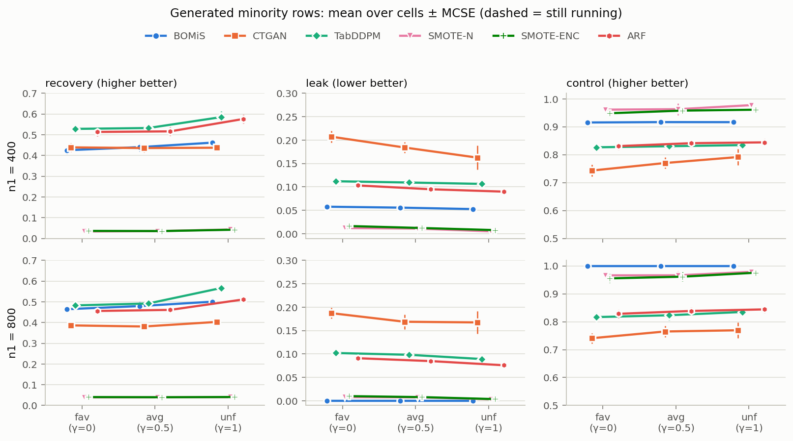
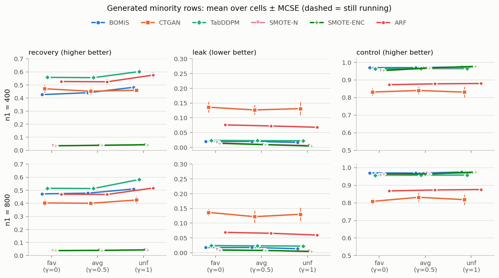
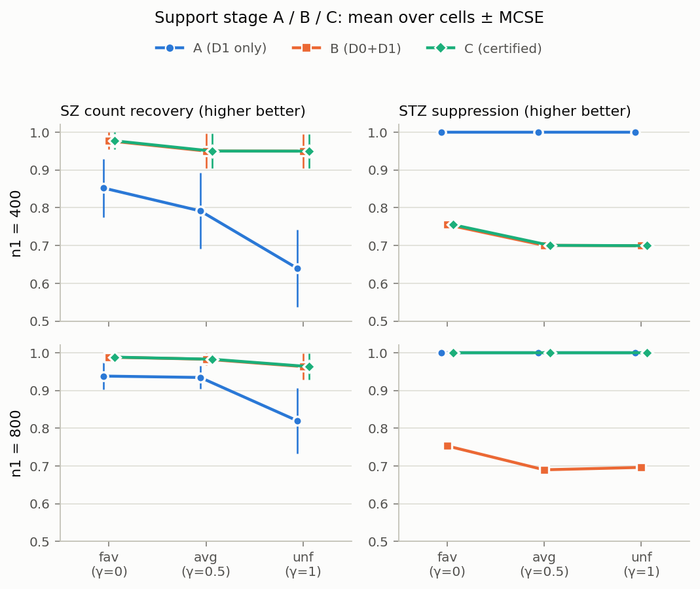
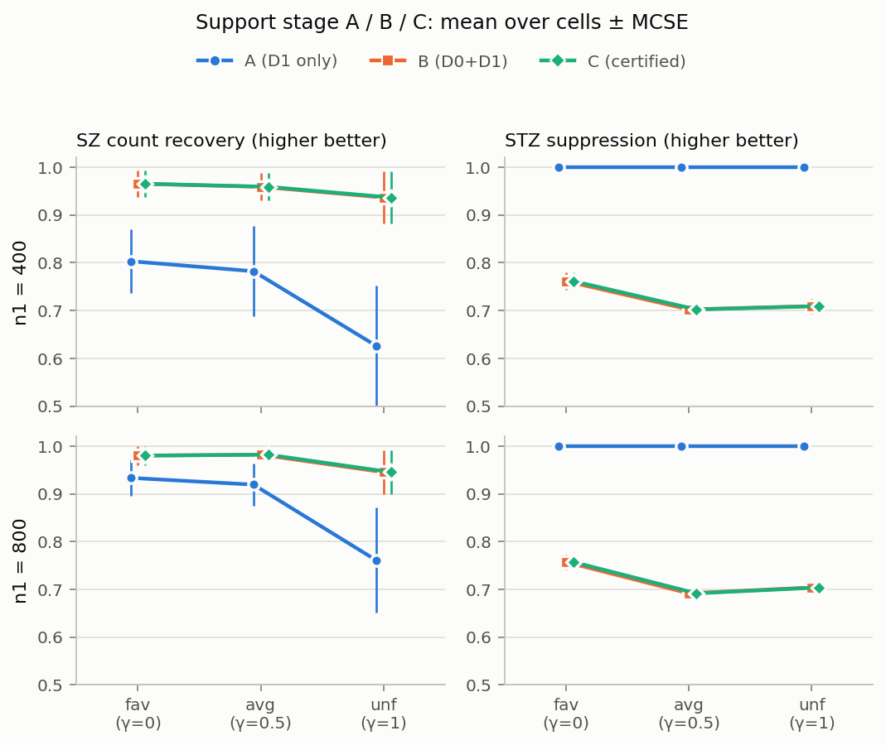

# mid·rare STZ 환경 합성 실험 결과 (2026-10-28)

frequent 결과(`reports/easy_results_1027.md`)와 같은 세팅을 STZ 수준 mid($\pi_0 = 0.03$)와 rare($\pi_0 = 0.005$)에서 돌린 결과다. 핵심 질문은 **BOMiS의 leak 0이 인증이 어려운 환경에서도 유지되는가**였다.

## 요약

- **BOMiS의 leak 0은 인증이 성공할 때만 유지된다.** 인증 결과는 설계 문서의 인증 경계 예측과 정확히 같았다. frequent는 $n_1 = 400, 800$ 모두, mid는 $n_1 = 800$만 금지 쌍 4개를 모두 인증했다. mid $n_1 = 400$과 rare는 하나도 인증하지 못했다. 거짓 인증은 모든 칸에서 0이다.
- **인증이 안 되면 BOMiS도 leak이 생긴다.** mid $n_1 = 400$에서 0.053–0.058, rare에서 0.013–0.020이다. support가 B($D_0 + D_1$, 인증 없음)와 같아지기 때문이다.
- **mid $n_1 = 400$에서는 인증이 안 돼도 BOMiS의 leak이 생성 baseline 중 가장 낮다.** TabDDPM은 0.106–0.112, ARF는 0.090–0.103, CTGAN은 0.16–0.21이다. SMOTE 계열(0.005–0.016)만 더 낮지만 recovery가 0.03–0.04다.
- **rare에서는 BOMiS의 우위가 사라진다.** TabDDPM의 leak(0.022–0.024)이 BOMiS(0.013–0.020)와 거의 같은데(짝 차이 0.003–0.009) recovery는 0.035–0.13 높다. rare 금지 쌍은 majority에서도 드물어서($\pi_0 = 0.005$) baseline도 그 셀을 거의 만들지 않는다.
- **recovery 패턴은 frequent와 같다.** $n_1 = 400$에서는 TabDDPM과 ARF가 BOMiS보다 0.08–0.13 높다. $n_1 = 800$에서는 ARF와 비슷하고(차이가 MCSE의 2배 안), TabDDPM보다는 낮으며, CTGAN보다는 0.07–0.10 높다. 손실 원인도 frequent와 같다. BOMiS가 만드는 SZ 셀 수가 가장 적어서 개수 손실이 가장 크다.

## 1. 실험 설정

| 항목 | 값 |
|---|---|
| 환경 | STZ 수준 mid·rare × 겹침 fav·avg·unf = 6환경 |
| 모집단·표본 | frequent와 같은 모집단 3개(pop 0–2), $n_0 = 8000$, $n_1 \in \{400, 800\}$, 표본 seed 0–9 → 방법당 360칸 |
| 방법 | support A/B/C, BOMiS, ROS, SMOTE-N, SMOTE-ENC, smote(SMOTE-NC 대체), ARF, CTGAN, TabDDPM. TabSyn·TabDiff는 시간 때문에 이번에 제외 |
| 실행 | job 23253(CPU 묶음), 23254(CTGAN), 23255(TabDDPM), 10/28 02:30–12:50, 실패 0 |

지표와 MCSE 정의는 frequent 결과 문서 1절과 같다.

## 2. 인증 경계와 BOMiS의 leak

| STZ 수준 | $n_1$ | 인증 신호 $s$ (설계 문서 4.6절) | C가 인증한 금지 쌍 (4개 중) | BOMiS leak | BOMiS control |
|---|---|---|---|---|---|
| frequent | 400 | 1.41 | 4 (180칸 모두) | 0 | 1.000 |
| frequent | 800 | 2.82 | 4 | 0 | 1.000 |
| mid | 400 | 0.71 | **0** (90칸 모두) | **0.053–0.058** | 0.915–0.917 |
| mid | 800 | 1.41 | 4 (90칸 모두) | 0 | 1.000 |
| rare | 400 | 0.12 | **0** | **0.017–0.020** | 0.970–0.974 |
| rare | 800 | 0.24 | **0** | **0.013–0.017** | 0.969–0.974 |

- 인증 결과가 $s$ 기준의 예측과 칸 단위까지 같았다($s \ge 1.41$이면 인증, $s \le 0.71$이면 실패). 경계 근처의 정확 검정력이 거의 0 또는 1이라서 그렇다.
- 인증되지 않은 칸에서 C의 support는 B와 같다(support 표의 SZ 회수·STZ 억제·$|\hat S|$가 B와 같은 값). 그래서 BOMiS는 금지 쌍 셀에도 새 행을 둔다.
- BOMiS의 leak은 대부분 금지 쌍 셀에서 나온다(9절 방식의 금지 쌍 행 비율: mid $n_1 = 400$ 0.054–0.059, rare 0.013–0.020).

## 3. 생성 결과 (BOMiS와 생성 baseline)

그림 1. mid 생성 행 지표. 위 줄 $n_1 = 400$, 아래 줄 $n_1 = 800$.

그림 2. rare 생성 행 지표.

recovery / leak, 세 겹침 환경(fav, avg, unf)의 30칸 평균이 놓인 범위. frequent는 비교용으로 함께 둔다.

| STZ | $n_1$ | BOMiS | TabDDPM | ARF | CTGAN | SMOTE-N |
|---|---|---|---|---|---|---|
| frequent | 400 | 0.424–0.458 / **0** | 0.497–0.548 / 0.191–0.200 | 0.502–0.550 / 0.115–0.133 | 0.421–0.429 / 0.235–0.247 | 0.032–0.040 / 0.013–0.021 |
| frequent | 800 | 0.435–0.485 / **0** | 0.460–0.532 / 0.147–0.171 | 0.443–0.491 / 0.098–0.113 | 0.359–0.388 / 0.233–0.241 | 0.038–0.040 / 0.007–0.015 |
| mid | 400 | 0.425–0.462 / **0.053–0.058** | 0.528–0.585 / 0.106–0.112 | 0.514–0.576 / 0.090–0.103 | 0.436–0.439 / 0.163–0.207 | 0.033–0.043 / 0.005–0.012 |
| mid | 800 | 0.464–0.501 / **0** | 0.483–0.567 / 0.089–0.102 | 0.456–0.511 / 0.076–0.091 | 0.381–0.403 / 0.167–0.187 | 0.039–0.040 / 0.003–0.008 |
| rare | 400 | 0.426–0.482 / **0.017–0.020** | 0.556–0.603 / 0.022–0.023 | 0.524–0.576 / 0.068–0.076 | 0.452–0.471 / 0.127–0.136 | 0.035–0.042 / 0.006–0.016 |
| rare | 800 | 0.472–0.510 / **0.013–0.017** | 0.513–0.583 / 0.022–0.024 | 0.468–0.517 / 0.060–0.069 | 0.401–0.425 / 0.122–0.136 | 0.038–0.044 / 0.005–0.010 |

같은 칸끼리 짝 차이 (BOMiS − 방법, recovery ± MCSE의 범위, 세 환경)

| STZ | $n_1$ | − TabDDPM recovery | − TabDDPM leak | − ARF recovery | − CTGAN recovery |
|---|---|---|---|---|---|
| mid | 400 | −0.092 ~ −0.123 | −0.054 | −0.076 ~ −0.114 | −0.014 ~ +0.025 |
| mid | 800 | −0.013 ~ −0.066 | −0.089 ~ −0.102 | −0.011 ~ +0.018 | +0.078 ~ +0.098 |
| rare | 400 | −0.115 ~ −0.132 | −0.003 ~ −0.006 | −0.084 ~ −0.100 | −0.045 ~ +0.023 |
| rare | 800 | −0.035 ~ −0.073 | −0.006 ~ −0.009 | −0.007 ~ +0.010 | +0.069 ~ +0.085 |

- mid $n_1 = 800$의 BOMiS − TabDDPM recovery는 fav(−0.018 ± 0.014)와 avg(−0.013 ± 0.016)에서 MCSE의 2배 안이고, unf(−0.066 ± 0.005)에서만 뚜렷하다. rare $n_1 = 800$은 세 환경 모두 TabDDPM이 MCSE의 2배 넘게 높다.
- BOMiS − ARF recovery는 $n_1 = 800$에서 mid·rare 모두 MCSE의 2배 안이다.
- **baseline의 leak은 $\pi_0$가 작을수록 줄어든다.** TabDDPM은 frequent 0.15–0.20 → mid 0.09–0.11 → rare 0.02, ARF는 0.10–0.13 → 0.08–0.10 → 0.06–0.08이다. 금지 쌍이 majority에서 드물수록 학습 데이터에도 드물게 나오기 때문이다. 반면 BOMiS는 인증이 되는 동안만 0이고, 인증이 안 되면 B의 support를 따른다.

## 4. 개수 회수와 손실 분해

frequent 결과 문서 9절과 같은 정의다(`scripts/compare_counts.py`, 전체 표 `reports/mid_counts.md`, `reports/rare_counts.md`).

| STZ | 방법 | 맞힌 SZ 셀 수 $k$ | 개수 손실 | 선택 손실 | 금지 쌍 회피 |
|---|---|---|---|---|---|
| mid | BOMiS | 927–1714 | 0.329–0.384 | **0.171–0.191** | $n_1 = 400$: 0, $n_1 = 800$: 1.0 |
| mid | TabDDPM | 1817–1861 | 0.217–0.331 | 0.171–0.198 | 0 |
| mid | ARF | 2040–2441 | 0.178–0.285 | 0.246–0.268 | 0 |
| mid | CTGAN | 1979–2237 | 0.197–0.307 | 0.295–0.369 | 0 |
| rare | BOMiS | 1055–1688 | 0.333–0.384 | **0.157–0.190** | 0 (unf $n_1 = 800$만 0.008) |
| rare | TabDDPM | 2026–2115 | 0.202–0.304 | 0.171–0.195 | 0 |
| rare | ARF | 2079–2508 | 0.185–0.279 | 0.239–0.256 | 0 |
| rare | CTGAN | 2098–2458 | 0.195–0.292 | 0.288–0.348 | 0 |

- frequent와 같은 구조다. BOMiS가 맞힌 SZ 셀은 TabDDPM의 0.5–0.9배, ARF·CTGAN의 0.4–0.8배라서 개수 손실이 가장 크다. 선택 손실은 BOMiS와 TabDDPM이 가장 작고 비슷하다.
- 금지 쌍 회피는 인증된 칸(mid $n_1 = 800$)의 BOMiS만 1.0이다. 나머지는 모든 방법이 금지 쌍 4개 전부에 행을 만든다.

## 5. support 단계와 BOMiS 손실 분해

그림 3. 왼쪽 SZ 개수 회수, 오른쪽 STZ 억제(위 mid, 아래 rare). 인증이 안 된 칸에서 C는 B와 같은 값이라 점이 겹친다.

- STZ 억제: C는 mid $n_1 = 800$에서만 1.0이고, 나머지는 B와 같은 0.69–0.76이다. A는 늘 1.0이다(설계상 local support).
- SZ 개수 회수: C(=B) 0.94–0.99, A 0.63–0.94. 겹침이 커질수록(fav → unf) A가 떨어지는 패턴은 frequent와 같다.
- BOMiS 손실 분해(그림 `mid_fig3_bomis_loss.png`, `rare_fig3_bomis_loss.png`): support 손실 0.004 이하, 개수 손실 0.33–0.38, 선택 손실 0.16–0.21로 frequent와 같다.

## 6. 해석

- BOMiS의 STZ 억제는 인증 단계 하나에 달려 있다. 인증이 켜지는 조건($n_1 r \pi_0$가 기준값을 넘는 구간)에서만 leak 0이고, 그 밖에서는 인증 없는 support(B)와 같아진다. 이 결과는 설계상 예측된 것이고 시뮬레이션이 그대로 재현했다.
- 인증이 안 될 때의 BOMiS는 "B의 support + Chao1 개수 규칙"으로 생성한다. 그래도 mid에서는 baseline보다 leak이 낮다. rare에서는 baseline도 금지 쌍을 거의 만들지 않아 BOMiS의 억제 우위가 없다.
- 그래서 "BOMiS = leak 없이 회수하는 방법"이라는 주장은 **인증 가능 구간**(frequent 전체, mid $n_1 \ge 800$)에서만 성립한다. 논문에서는 이 구간을 명시해야 한다.
- recovery 열세의 원인은 세 STZ 수준 모두 같다(Chao1 상한에 따른 개수 손실). frequent의 Chao1 상한 ablation(통합 문서 6.4절)은 mid·rare에서는 돌리지 않았다.

## 7. 주의

- 모집단 3개라 MCSE의 자유도가 2다. 개발용 모집단(seed 0–2)이며 최종 보고용 모집단(seed 1000번대)은 아직 쓰지 않았다.
- TabSyn과 TabDiff는 mid·rare에서 돌리지 않았다. frequent에서 TabDiff는 leak이 가장 낮은 baseline이었으므로, mid $n_1 = 400$에서 "BOMiS leak이 생성 baseline 중 가장 낮다"는 말은 TabDiff를 빼고 한 비교다.
- rare의 "BOMiS 우위 없음"은 TabDDPM과의 비교다. recovery 차이는 MCSE의 2배를 넘고 leak 차이는 0.003–0.009로 작다.

## 파일

| 내용 | 위치 |
|---|---|
| 자동 생성 표 | `reports/mid_report_tables.md`, `reports/rare_report_tables.md` (`scripts/make_easy_report.py --level mid/rare`) |
| 개수·손실 분해 | `reports/mid_counts.md`·`.csv`, `reports/rare_counts.md`·`.csv` (`scripts/compare_counts.py --level mid/rare`) |
| 그림 | `reports/figures/{mid,rare}_fig{1,2,3}_*.png` |
| 실행 계획·기록 | `experiments/plan_mid_rare.md`, `experiments/run_log_easy.md` "mid·rare 환경" 절 |
| 칸별 결과 | `/mnt/data1/calvinkim1027/BOMIS_new_수만이형_runtime/results/{mid,rare}_{fav,avg,unf}/<방법>/<pop>_<n1>_<seed>.csv` |
